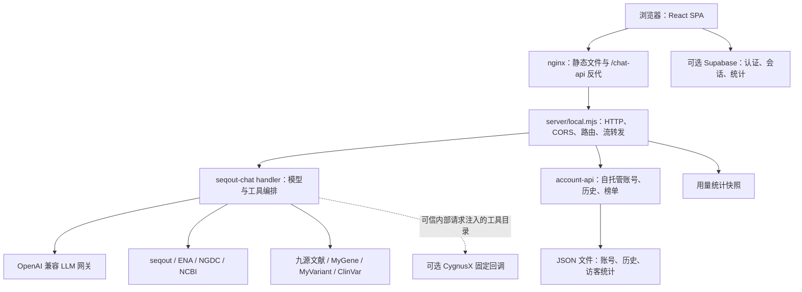

# 当前框架盘点与收敛建议

日期：2026-10-19。基于主仓库 `51a401d` 的代码核查；归档区仅确认边界，不纳入构建或修改。本次交付为架构盘点，不实施业务重构或缺陷修复。

## 1. 当前系统的定位

这是一个**对话驱动的科研检索应用**：组学数据、基因、变异与文献是主业务，账号和历史是基础服务，桌宠与排行榜提供反馈。主应用还没有形成论文上传 → 解读 → 数据导入 → 分析执行的产品闭环。

技术框架是 React 19 + TypeScript + Vite 7 + TanStack Router + Tailwind v4；服务端是 Node 原生 HTTP 壳，复用可在 Node/Deno 运行的 TypeScript 对话 handler。LLM 使用 OpenAI 兼容的 tool-calling 接口。这里的“工具”是函数 schema 加 HTTP 适配器，主链路不启动 Python MCP 服务。

当前复杂度主要来自**同一入口承担的职责增多、存储模式分支、跨层契约分散**。现有工具适配器、SSE 和卡片可以继续复用，适合沿领域边界渐进拆分。

## 2. 实际运行拓扑



- Docker 是 `web` + `chat` 两个容器；自托管账号与对话运行在同一个 Node 进程。开发时 Vite 监听 3015，Node 默认监听 `127.0.0.1:8787`，可经 Vite `/chat-api` 代理。
- `VITE_CHAT_API` 决定对话地址；未设置时指向 Supabase URL 下的 Edge Function。`VITE_SUPABASE_URL/ANON_KEY` 决定账号和存储模式，两组配置是独立维度。
- `isOfflineMode` 实际表示“未配置 Supabase”。此时仍会访问 Node、LLM 和公共数据 API，不代表断网可检索。
- CygnusX 内部入口为 `POST /cygnusx/discovery`，先验证内部 token，再标记可信工具目录；可用 `TREASURE_MOUSE_PLATFORM_ONLY` 限制入口。普通浏览器路径会移除可信标记。外部平台是否真正完成导入/分析，不由本仓库的适配器证明。

## 3. 功能归属与成熟度

| 功能域 | 当前代码与职责 | 主应用状态 |
|---|---|---|
| 对话与工具编排 | `functions/seqout-chat/index.ts`：模型目录、40 轮循环、工具分派、事件、卡片、用量 | 已接入；真实上游可用性需 live 验证 |
| 组学检索 | 同一文件：seqout 26 工具、ENA 直连、NGDC 5 工具、NCBI 兜底、GSE 映射 | 已接入，有离线回归 |
| 基因/变异/临床证据 | `functions/seqout-chat/biomed/`：schema、校验、MyGene/MyVariant/ClinVar 适配与卡片 | 已模块化，值得作为后续拆分范例 |
| 文献 | 后端九源主动搜索；`src/services/literature.ts` 按编号查单篇证据链 | 两条已接入的路径，不能混为一个接口 |
| 意图与编号核验 | `intent.ts` 归一化 IR；handler 收尾 grounding、文献补链 | 已接入；编号存在不等于科学结论或数据归属成立 |
| 会话与身份 | `src/routes/index.tsx` + `chatStore.ts` + `localAuth.ts` | Supabase 与自托管双路径，分支集中在首页 |
| 统计 | handler 用量 + `statsStore.ts` 榜单成绩 + `petStore.ts` 宝藏/成就 | 三套不同口径，分别持久化 |
| 互动展示 | `components/pet/`、`petBus/hintBus/evidenceBus`、主题和 i18n | 已接入；桌宠消费对话事件，不承担检索执行 |
| 平台展示扩展 | `presentation-contract.ts` / `presentation-context.tsx`，卡片可选平台动作 | 主 SPA 未提供 `PresentationContext.Provider`，动作不会自行启用 |
| 论文证据 | `scripts/paper_evidence.py` 与 Python 测试；`verifyPaperMentions()` 为可复用 helper | 离线索引/辅助函数；无主 SPA 上传、解读或分析闭环 |
| 历史实验 | `archive/qmuse`、`weixin`、`crawler`、`island` | 已归档；不属于当前产品能力 |

静态工具 schema 共 **40 个**：26 seqout + 5 NGDC + 1 ENA + 1 文献 + 6 biomed + 1 `intent_plan`。其中意图工具不请求外部 API、不计检索用量；可选平台工具按可信目录额外注入，不计入这 40 个。

## 4. 一次提问怎么流动

1. `src/routes/index.tsx::handleSend` 创建用户/助手消息，收集历史，调用 `requestSeqoutChat()`。
2. `src/services/seqoutChat.ts` POST 消息、模型和语言；handler 只保留最近 16 条历史，附双语系统提示词。
3. 模型分片返回正文或工具调用；`intent_plan` 在本地校验归一化，其他工具由 `executeTool()` 或平台适配器执行。当前同轮工具通过 `for...of` 依次执行；文献 `source=all` 内部并发查询九源。
4. 工具结果一份压缩到最多 100000 字符供模型继续推理，另一份投影成卡片发前端；卡片不会跟随模型上下文截断。
5. 主循环结束后按条件补文献、发下载加速推荐、核验正文编号，最后发送 `end` 和 `[DONE]`。
6. 首页处理文本/卡片/轨迹，转发桌宠事件，上报排行榜，并按身份路径持久化。

| 下行消息 | 语义 | 当前消费者 |
|---|---|---|
| `delta` | 正文增量 | SSE service → 首页 |
| `event:tool` | 单工具 running/done/error | 工具轨迹、桌宠、挖掘次数 |
| `event:cards` | **本次工具的一批卡片增量** | 首页；见 §7 的覆盖问题 |
| `event:polariseq` | 下载加速推荐 | `DownloadBoostCard`；不是下载执行器 |
| `event:grounding` | 未证实编号及已确认编号 | `GroundingNotice` |
| `event:platform_tool` | 外部平台工具返回结果 | 普通 SPA SSE service 跳过此事件 |
| `event:end` | 本轮累计 cards 与 tool_logs | 首页收尾 |
| `error` / `[DONE]` / `: ping` | 错误 / 结束 / 心跳 | SSE service |

协议目前靠后端发送、service 解析、页面回调三处协作。`DatasetCard`、`ToolLog`、SSE 事件并没有统一的前后端共享运行时校验契约；`presentation-contract.ts` 是平台展示契约，不能替代对话协议。

## 5. 数据到底存在哪里

| 数据 | 游客 | 自托管登录 | Supabase 登录 |
|---|---|---|---|
| 会话 | 浏览器 `seqout-local-session`，最多 50 条/7 天 | 同一浏览器存储，登录合并后防抖 PUT `/history` | `chat_sessions` / `chat_messages` |
| 身份 | 设备 ID | 本地 token + Node `accounts.json` | Supabase Auth + profiles |
| 榜单 | Node guest 行，本地镜像作回退 | Node account 行，登录合并本机游客成绩 | 云表与 RPC |
| 桌宠、主题、成就 | localStorage | 仍为浏览器偏好 | 仍为浏览器偏好 |
| LLM/工具用量 | handler 进程内聚合，不是个人成绩 | Node 定时落盘 | handler 聚合；Deno 部署无 Node 文件持久化 |

Node 账号、历史、榜单默认在 `server/data/`；**用量快照默认另在 `server/.stats.json`**。Docker 设置 `STATS_FILE=/app/data/stats.json`，账号目录随其目录落到 `/app/data`，共用命名卷。不能直接把裸跑默认目录与容器目录混用。

`account-api.mjs` 是进程内缓存 + JSON 整文件 + 400ms 防抖原子替换。它适合当前单进程部署；原子替换解决单次写文件完整性，不提供多实例事务或跨进程锁。

云端表名与 RPC 可由客户端代码和生成类型核对，但主仓库没有 SQL migration/RLS 定义。本次没有访问线上数据库，**不声称已验证线上 RLS 策略**。

## 6. 为什么现在会感觉功能过多

| 集中点 | 当前规模 | 职责叠加与拆分方向 |
|---|---:|---|
| `functions/seqout-chat/index.ts` | 2147 行 | HTTP handler、用量、schema、多个数据源、文献、卡片、grounding、循环同时存在；保留编排入口，逐步抽领域适配与纯函数 |
| `src/routes/index.tsx` | 802 行 | 布局、身份、会话过期、同步、流消费、统计、桌宠联动；优先抽会话/流生命周期 |
| `TreasureMouse.tsx` | 812 行 | 15 个状态、拖拽、计时器、造型、台词、计数、成就；适合拆纯状态转移与展示 |
| `src/styles.css` | 934 行 | 主题 token、页面、卡片、桌宠动效集中；后续按主题/组件/动效整理并维持 token 单源 |
| `src/components/ui/` | 46 个文件 | 静态 import 核对：业务文件直接使用 6 个，35 个文件未被其他 src 文件直接导入；含未启用组件链，清理前应继续核对完整依赖可达性 |

React Query Provider 已挂载，但当前 `src/` 没有 `useQuery/useMutation/useInfiniteQuery` 调用；实际状态由 hooks、service、localStorage 管理。重构前应先明确现有状态归属，避免再增加一套并行状态系统。

本次构建主 JS chunk 为 **1206.08 kB，gzip 368.21 kB**，触发 Vite 500 kB 提醒。可评估路由与重组件延迟加载；未被业务使用的 UI 文件不等于都进入 bundle，不能仅凭目录大小判断性能原因。

## 7. 已发现的契约问题

以下为待修复项，本次不修改业务代码。优先级按当前功能影响排序；静态结论与动态验证分别标明。

2026-10-20 补充：这五项的文件级改动、身份与事件契约、旧数据迁移、发布兼容及验收清单见 [详细优化实施方案](reliability-optimization-plan-2026-10-20.md)。原问题保留为审计快照；后续代码修复与验收范围见 [2026-10-20 实施记录](reliability-fixes-2026-10-20.md)，线上数据库迁移仍需单独应用。

### 7.1 自托管登录历史的身份与保留策略混用（P1，静态核对）

位置：`src/routes/index.tsx:50–100, 185–196, 227–293, 535–546`。

本地会话 key 不按账号分区，登录时把本地列表合并进当前账号，退出后保留本地列表；`readLocalSessions()` 的 7 天/50 条游客规则也用于自托管登录与服务端历史推送。切换不同账号有把上一个账号本机历史合入新账号的风险。启动 `localMe()` 恢复身份后也没有先拉远端历史的步骤，已有本机快照可能先 PUT 到服务端。

应先约定账号分区、游客迁入时机、登录恢复的拉取/推送顺序、账号历史保留策略，再写同步适配。需要浏览器验证刷新、跨设备、切账号与过期场景，本次尚未完成这些交互验收。

### 7.2 开启共享密钥后普通 Web 请求没有配套认证（P1，已动态复核）

位置：后端 `functions/seqout-chat/index.ts:1802–1807`；前端 `src/services/seqoutChat.ts:55–65`；`server/local.mjs:73–77`；`deploy/nginx.docker.conf`。

handler 要求 `X-Chat-Key`，当前前端请求不提供，Node CORS 也未声明该头，随仓库提供的 nginx 配置未注入该头。用合成凭据配置 `CHAT_SHARED_SECRET` 后，按当前浏览器头调用 handler 得到 **401**。CygnusX 内部入口的服务端注入是另一条路径，不能补齐普通 Web。

后续应明确由账号授权还是受控服务端代理承接密钥门禁。不要将服务端共享秘密打进公开前端 bundle，也不能只新增 CORS 头便视为闭环。

### 7.3 cards 增量被前端当快照覆盖（P1，handler 输出已动态复核）

位置：后端 `index.ts:1980–1981, 2039, 2083`；前端首页 `421–439`。

离线 mock LLM 连续调用两次工具，handler 实际发送 `cards=[A]`、`cards=[B]`、`end.cards=[A,B]`；首页每次 `onCards` 都执行 `finalCards = cards` 并覆盖消息卡片。结果是流式期间只显示最后一批，正常收到 end 后才恢复；end 前异常中断时早先卡片可能丢失。桌宠/统计还会将批次数量与累计数量混用。

先固定“cards 增量、end 累计”的契约，再由前端统一累积/去重，并明确中断后的保留规则；不要为了迁就前端静默改变既有 SSE 语义。

### 7.4 自托管账号改昵称时 token 位置不一致（P1，已动态复核）

位置：`src/services/localAuth.ts:141–145` 与 `server/account-api.mjs:243–258`。

前端把 token 放 JSON body 并设置 `auth:false`；服务端该路由只读 Authorization Bearer，导致登录用户请求按访客处理。直接调用现有 Account API 复现：body token 返回成功但账号昵称不变；改用 Bearer 后账号昵称改变。`/stats/bump` 支持 body token，不代表 `/stats/nickname` 也支持。

### 7.5 云端历史的消息字段少于当前界面模型（P2，静态核对）

位置：`ChatMessage.tsx:29–45`、`chatStore.ts:12–18, 56–83`、首页 `309–318, 489–494`。

界面消息包含 `grounding` 和 `boost`，云端读写仅保留 role/content/cards/tool_logs。重载云端历史无法恢复原有核验灰条和下载推荐；localStorage 路径则保存整条消息，出现双模式差异。应定义持久化消息模型及兼容规则，再决定是否迁移字段或按证据重建；不要把 UI 中间态全部存库。

## 8. 建议收敛顺序

| 顺序 | 工作 | 可评审的完成条件 |
|---|---|---|
| 1 | 修复 §7 的身份/事件/认证契约问题 | 切账号不串历史；恢复先合并再推送；多批卡片与中断不丢；账号改名落账号；开启鉴权仍可正常对话 |
| 2 | 抽前端 `useConversation`、会话存储适配和独立宠物事件映射 | 首页以布局与组合为主；游客/本地账号/云账号由明确适配器承接；保留既有行为 |
| 3 | 参照 biomed 抽后端 `omics/`、`literature/`、`grounding/`、`usage/` | handler 保留编排；共享网络/NCBI 配额只从 `shared.ts` 获取；现有导出兼容测试入口 |
| 4 | 固定共享对话契约与恢复规则 | 前后端同一事件类型来源；明确增量/快照、终态、中断、持久化字段；不引入 Node-only 运行时依赖 |
| 5 | 清理未使用 UI/依赖，做分包与文档对齐 | 依赖可达性和产物体积有证据，构建/类型检查通过；README 双语和关于页按契约同步 |

目标目录仅作为后续重构建议，**当前尚未创建**：

```text
src/features/chat/           # 对话状态、事件归并、生命周期
src/features/session/        # 游客 / 自托管 / Supabase 存储适配
src/components/pet/          # 展示与互动，消费明确事件
functions/seqout-chat/
  index.ts                   # HTTP 与编排入口
  shared.ts                  # 网络、配置、共享配额（已有）
  intent.ts                  # 意图校验（已有）
  biomed/                    # 基因、变异、ClinVar（已有）
  omics/ literature/ grounding/ usage/   # 按域逐步抽取
server/                      # Node 壳、账号、落盘
```

每次只迁一个边界，迁移与行为修复分开验证。无需先拆成微服务；当前 JSON 存储仍要求单写进程。论文/分析扩展应另行验收，按 [ADR](paper-to-analysis-adr.md) 明确平台归属。

## 9. 文档漂移与本次验证

已确认的文档漂移：

- 根 `AGENTS.md` 称后端默认 `qwen3.8-flash`，实际代码缺省是 `qwen3.6-plus`；前端 fallback 和 `.env.example` 是 `qwen3.8-flash`。正常配置 `LLM_MODEL` 可覆盖，不能据文档推断缺省一致。
- 根 `AGENTS.md` 的“无其他第三方运行时依赖”与 `package.json` 不符；实际有 React、Router、Markdown、Radix 等。Node 对话服务零 npm 依赖与前端依赖清单是两个不同范围。
- 旧架构文档的 12 状态、仅 seqout/早期文献来源、裸跑用量存储路径已不足以描述现状；桌宠现在有 15 个状态（含 welcome/read/litfound）。
- 中英文 README 的章节、顺序与内容覆盖未按根约定对齐；后续对外文档整理需双语及关于页一起核对。本次仅更新 ARC 盘点入口，不重写产品介绍。

本次验证环境 Node **v24.13.0**，按已有 `pnpm-lock.yaml` 执行 `pnpm install --frozen-lockfile`，未改依赖清单/锁文件：

| 检查 | 本次结果 | 覆盖边界 |
|---|---|---|
| `npm test` | 133 项：132 通过、1 跳过、0 失败 | 后端离线回归与 Account API；跳过项依赖 `CYGNUSX_TEST_CATALOG_PATH`，未提供外部平台目录 |
| `npm run typecheck` | 通过 | `src/**/*` 与 `vite.config.ts`；**不覆盖后端 TypeScript、server、归档** |
| `npm run build` | 通过；主 chunk 超 500 kB 提醒 | SPA 构建，不证明浏览器交互或外部服务可用 |
| `python3 -m unittest discover -s scripts/tests -v` | 17 项：12 通过、5 跳过 | 证据索引契约；缺 OmicHub PDFProcessor 环境，未证明真实 PDF 集成 |
| zh/en 键集合与重复检查 | 各 404 键；集合相同，无重复 | 字典结构；未做逐条翻译质量审查 |
| handler 离线 smoke | 40 schema、两次模型请求、两批卡片及 end 累计断言通过；无共享头返回 401 | 全局 fetch mock，无真实 LLM/API 费用或线上变更 |
| 昵称契约复现 | body token 未改账号名，Bearer 成功修改临时账号 | 直接调 Account API，数据仅在系统临时目录，不涉及真实账号 |

本次未运行真实上游 live 测试、浏览器 E2E、Docker 重建、线上数据库/RLS 或外部 CygnusX 端到端验收。没有改数据源解析、提示词、工具执行或协议实现，不据离线全绿宣称这些范围通过。

后续验证应优先补到**边界组合**：多工具卡片 → 页面状态 → 中断/恢复 → 不同身份持久化，以及本地登录恢复/切换账号。现有测试主要守住领域函数正确性，尚不足以覆盖这些跨层行为。
