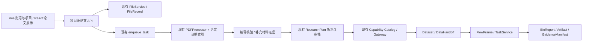

# Paper → Data → Analysis：架构审计与实施记录

日期：2026-10-17。范围：寻宝鼠子仓及上级 OmicHub 的只读源码调查。分支：`feat/paper-data-analysis`。调查先于本任务代码修改；已有未提交改动未清理、未覆盖。

## 1. 现状与证据

下表的“已有实现”表示源码存在，不等于运行验收。除单独列出的实际命令结果外，本次未验证平台部署、权限、数据库、队列或计算环境。

| 能力 | 位置（相对 OmicHub） | 状态与限制 |
|---|---|---|
| Vue 平台入口 | `frontend/src/views/TreasureResearchWorkbench.vue`、`components/research/TreasureOriginalDisplay.vue` | 已有实现，React island 承载原样式；本次未经浏览器验证 |
| 四卡首页 | `pipelines/Treasure-Seeking_Mouse/src/components/chat/EmptyState.tsx` | 已有四卡，不应增加第五卡；当前没有论文工作区 |
| 对话附件上传 | `src/cygnusx/api/v1/files.py` 的 `/chat-upload`、分块 `/upload/*` | 已有用户隔离存储、下载所有者校验；聊天上传使用 `await file.read()`，不能直接认定满足论文大小/资源限制，也不等同于 FileRecord 工作流资产 |
| PDF 解析 | `application/services/pdf_processor.py`、`pdf_models.py`、`infrastructure/pdf/*` | **已有 PDFProcessor**：pdf-inspector 灰度主路径、pypdf 降级、页面模型、OCR 标志、截断标志。平台 `.venv` 能导入两依赖；系统 Python 不具备。不能重复建设解析器 |
| PDF 质量门禁 | `PDFProcessor.process_sync()` / `QualityGate.pre_check()` | 大小预检失败仍走 fallback；pypdf 跳过空页且未标 OCR。因此论文入口必须先独立拒绝超限，再按总页数与实际页号补缺页警示 |
| 文献检索 / 元数据 | 子仓 `functions/seqout-chat/index.ts`，父仓 `research_treasure_service.py` / `research_agent.py` | 已有九源检索、DOI/PMID 元数据与摘要 outline；**摘要不能冒充全文**；未见 DOI/PMID → 完整论文解析工作区服务 |
| GEO/SRA/ENA/GSA | 子仓 `functions/seqout-chat/index.ts`；父仓 dataset discovery | 已有只读检索、GSE 权威字段映射、ENA 直连、NCBI 兜底；GSA 依赖镜像，无公开直连搜索实现 |
| Capability Catalog / Gateway | `application/schemas/agent_tools.py`、`services/agent_tool_gateway.py` | 已有共享 catalog、context 重验、能力级 scope、有限委托；子仓 `platform-tools.ts` 负责固定目标回调。不是新增 Agent/MCP 的理由 |
| Dataset / FileRecord | `infrastructure/database/models/{dataset,file}.py`，`dataset_service.py`、`dataset_handoff_service.py` | 已有数据版本、样本组审核、资产角色、DataHandoff 与冻结 manifest。复用，不新增平行数据库 |
| 下载 / 计算 | `download_service.py`、`task_service.py`、`dataset_import_service.py` | 已有源码；Agent 写入口 `WRITE_RUNTIME_ACCEPTED=False`，导入也调用同一门禁。**批准不等于可执行，附件验收 7 尚不满足** |
| 方案 / 版本 / DAG | `schemas/research_plan.py`、`research_plan_service.py`、`api/v1/research_plans.py` | 已有严格 DAG/端口校验、摘要绑定 review、版本与事件；视图 `mode=PLAN_ONLY`，`LIVE_EXECUTION_BLOCKED` 为显式 gap；不是完整执行闭环 |
| FlowFrame / RNA-seq | `flow_registry.py`、`flow_service.py`、`analysis_flow_tool_service.py`、`flows/` | 已有 YAML 注册表与受控流程匹配；须由真实 dataset handoff 选择兼容 flow，不能靠论文关键词直接提交 |
| 报告 / 证据 | `bioreport_adapter.py`、`research_delivery_service.py`、`report_snapshot_manifest.py`、`artifact_manifest.py`、`execution_evidence_service.py` | 已有 Artifact/Snapshot/EvidenceManifest/交付包；论文原文证据尚未接入，不得生成假 task/report ID |
| 异步机制 | `infrastructure/task_queue/dispatcher.py`、`celery_app/tasks/*` | 已有 Celery / RocketMQ / hybrid 统一 enqueue；另有 ARQ 文件。实际启用后端取决于 settings，本次未核实运行 worker |
| 测试 / 部署 | `tests/unit/test_research_*`、`test_dataset_gateway_phase3.py`、`test_pdf_processor.py`；`deploy/docker/` | 已有测试和部署定义；文件存在不能证明测试或容器在本机运行通过 |

完全缺失或未发现的集成：论文实体及解析任务 API、受限论文 URL 获取器、全文获取状态、论文结构化解读及 claim → 原文定位、补充材料跟踪、论文匹配 A/B/C 分类、论文证据绑定方案版本、完整四标签工作区、Paper→批准执行→BioReport 的真实 E2E。现有工作流 UI 是 read/prepare 展示，不是这些功能的实现。

## 2. 模块边界与依赖

解析层只产出可定位原文和明确缺口；解读层每个结论引用证据 ID，不能把 PDF 内容提升为指令。溯源层分 A（明确引用且核验）、B（文献关联）、C（相似候选），另外保留“仅提及、未核验”。数据库记录存在不证明它属于论文。规划层区分原文方法、推荐、未确认假设；执行层只认平台批准版本、权限与门禁。

## 3. 复用接口

平台 API 相对于 `/api/v1`（实际挂载前缀须接入时核对）：

- `files.py` 的 `POST /files/upload/{init,chunk,merge}`：优先产出受用户/项目管理的 FileRecord；不能用浏览器文件路径或任意 URL 替代资产 ID。
- `research_agent.py`：既有会话、消息流和 `/sessions/{session_id}/literature`。保持兼容，全文任务不挤入 SSE tool 循环。
- Gateway：`dataset.discover`、`dataset.inspect`、`dataset.prepare_import`、`analysis.list_compatible_workflows`、`analysis.prepare_from_dataset`、`tasks.get_status`、`research.task_provenance`、`research.project_delivery`。目录由服务器提供，不在前端维护可执行能力副本。
- `POST /projects/{project_id}/research-plans`、`/{plan_id}/versions`、`/review`、`/advance`、`/reconcile`：复用 `cygnusx.research_plan.v1`，review 绑定 `expected_digest`，不能新设一条“论文直接执行”入口。
- `datasets.py`：版本资产、样本审核、`/handoff/freeze`、`/compatible-workflows`、`/analysis-prepare`。
- `research_delivery.py` / report 服务：最终交付读取真实任务来源与 Artifact，不另建报告引擎。

## 4. 最小新增契约（设计，尚非在线 API）

详见 [ADR](paper-to-analysis-adr.md)。建议新增 **PaperDocument**（来源 FileRecord 或规范文献标识，原文件 SHA256，解析器版本）与不可变 **PaperRevision**（解析状态、章节/页文本、claims、证据索引、数据库核验快照）。原文件和衍生 JSON 继续使用 FileRecord/Artifact，任务继续使用 Task/队列。引用既有 DatasetVersion/ResearchPlanVersion/Report ID；不复制其生命周期。

建议项目级 API：

| 请求 | 语义 |
|---|---|
| `POST /projects/{project_id}/papers` | `file_record_id` 或互斥 DOI/PMID/受限 URL；owner 从认证上下文推导；幂等 request_key；202 返回真实 task_id |
| `GET /projects/{project_id}/papers/{paper_id}` | 真实 queued/running/failed/partial/succeeded 状态、revision、gaps，不按时间模拟进度 |
| `GET .../revisions/{revision}/evidence/{evidence_id}` | 原文件摘要、页码、章节、精确片段/字符范围；无版面信息则 bbox/table/figure 为 null |
| `POST .../revisions/{revision}/trace` | 重新核验编号/关联/补充材料，记录来源、时间、状态、匹配依据；失败保留 unknown，不变成 missing |
| `POST .../revisions/{revision}/analysis-plan` | 提交科学问题 + 真实 dataset version，引导既有 plan prepare，返回版本/缺口；不执行 |

这些是**提议**，本分支没有注册上述路由，调用方不得假定已可用。

## 5. 实施顺序与验收

| 阶段 | 交付与独立门禁 | 当前状态 |
|---|---|---|
| 0 | 本审计、ADR、接口草案、逐项风险 | 已落盘；跨仓部署事实待验证 |
| 1 | 复用解析器、PDF/DOI/PMID/URL、全文状态、原文定位、真实失败/OCR、四标签中的解读 | 仅开始离线 PDF 证据索引；整体未通过 |
| 2 | 编号与精确证据、真实数据库核验、A/B/C、防候选冒充、补充材料 | 未通过；提及提取不能代替核验 |
| 3 | 真实元数据约束方案、方法来源/推荐/假设、版本、统计风险 | 未接入；已有 plan 是复用依赖 |
| 4 | 编辑 DAG、校验、摘要审批、FlowFrame、受控执行与真实任务 | 平台写门禁关闭，未通过 |
| 5 | BioReport/Manifest 证据链、浏览器桌面/移动/明暗、端到端与异常场景 | 未通过 |

逐项最终验收清单（均需运行证据，不以编译代替）：真实论文结构化；编号原文定位；真实数据库与 A/B/C；真实设计→方案；可编辑可校验 DAG；未批准无任务；批准后真实任务状态；报告/参数/来源/证据闭合；解析失败/无编号/数据库失败/权限/任务失败；API/浏览器/E2E。当前都不能宣称完整完成。

## 6. 风险与约束

- 当前授权写入根仅为寻宝鼠子仓和 `/tmp`；上级 Vue/FastAPI/DB/队列文件可读不可写。后续平台接入需要在允许写入 OmicHub 的工作区继续，不能通过子仓符号链接或其他方式绕过限制。
- 本地依赖已存在不代表生产可用。先复用 PDFProcessor；GROBID/Docling 如需引入，另测内存、并发、OCR、表格质量与部署成本，不加入核心依赖。
- 任意论文 URL 有 SSRF/重定向风险；仅允许 HTTPS 文献站域名、每跳重新检查公共地址、大小/超时限制、拒绝私人网络。不能把 DOI resolver 任意重定向当成安全下载。
- PDF 空页可能是扫描、图片或真正空白；只能标“可能需要 OCR”，不能伪称已 OCR 或确定扫描。参考文献里的编号不能直接断言本研究使用。
- 论文正文和模型建议都是非可信数据；审批摘要、能力目录、权限和任务状态只能由平台服务产生。
- 当前无浏览器工具、尚无真实平台执行验收。禁止为完成演示而打开既有写门禁。

验证结果与下一步见 [实施与测试记录](paper-to-analysis-validation.md)。
