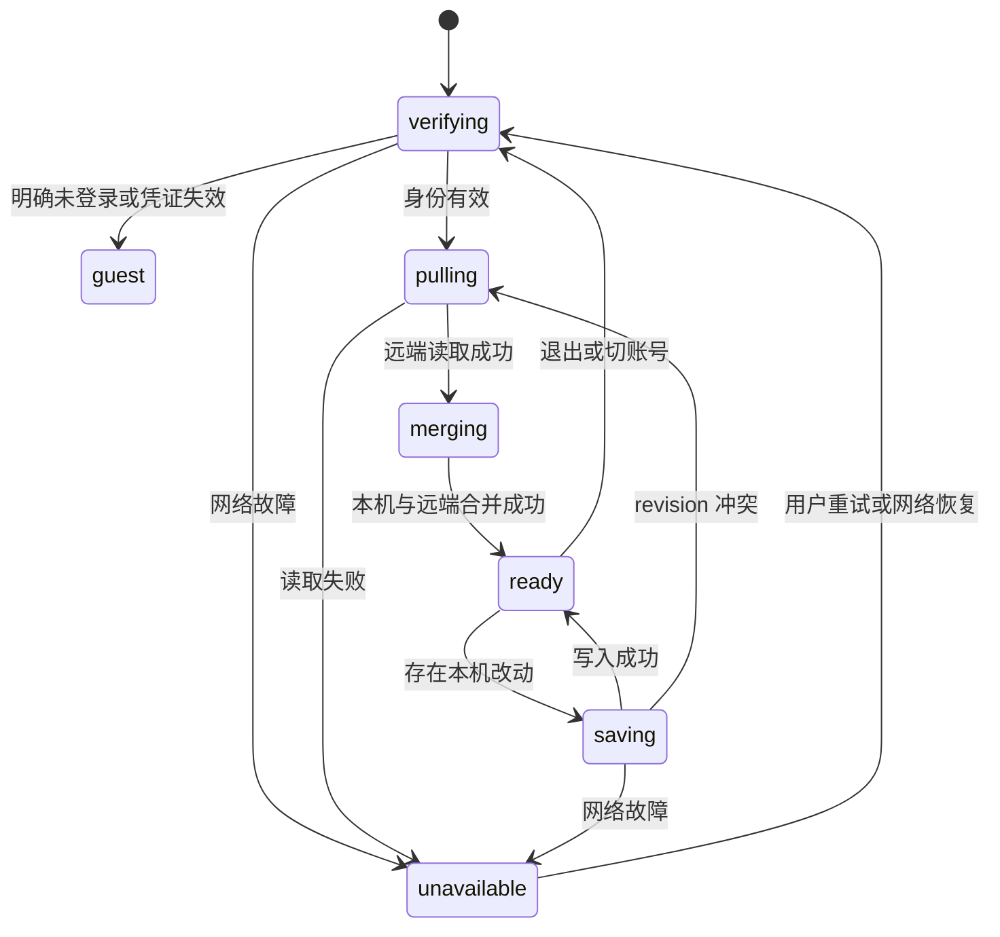
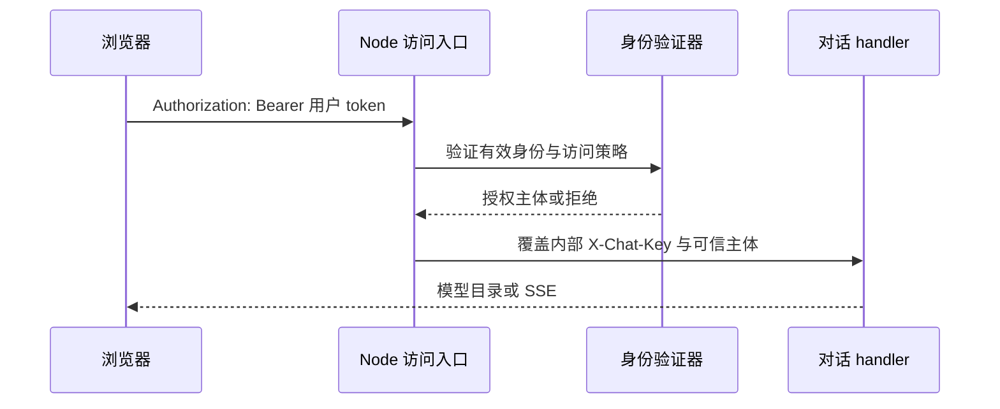

# 历史、认证与对话状态可靠性优化实施方案

日期：2026-10-20。本文保留设计基线；五项代码修复及迁移文件现已提供，已验证范围与未执行的线上步骤见 [实施记录](reliability-fixes-2026-10-20.md)。下文的目标验收清单仍按原方案保留，不代表所有部署形态已验收。

基线为当前主仓库实现，问题证据见 [2026-10-19 框架盘点 §7](architecture-review-2026-10-19.md#7-已发现的契约问题)。本文将五项问题落实为设计、文件级改动、兼容迁移、实施阶段和验收清单，可作为后续开发任务说明。下文出现的新文件、接口字段、配置项和测试均为**拟新增**，不得据此宣称已存在或已验收。

## 1. 目标、范围与约束

| 编号 | 当前问题 | 修复后应满足的行为 |
|---|---|---|
| H1 | 本地历史不按账号分区，恢复身份后可能先推送旧快照 | A/B/游客历史隔离；恢复先拉取合并再同步；旧版本不能覆盖新快照 |
| A1 | 开启共享密钥后普通 Web 没有配套认证 | 浏览器用身份凭证；服务端验证并授权后内部附加共享密钥 |
| C1 | cards 增量被当作快照覆盖 | 多批卡片持续累积；重复结果正确合并；断流保留已到达结果 |
| N1 | 昵称请求把 token 放在 body，服务端只读 Bearer | 登录昵称修改落账号；游客昵称修改落设备；无效凭证不降级成游客 |
| M1 | 云端历史缺少 grounding/boost | 新消息重载后保留核验提示和下载推荐；旧消息保持可读 |

以修复这五项为交付边界，先稳定数据和接口，再按盘点文档拆分大文件。本轮不扩展论文上传、分析执行、数据源数量、桌宠玩法，不迁移归档版本。

共同约束：

- 遵守根 `AGENTS.md` 与 [ARC 手册](README.md)。GSE 权威编号解析、业务空矿语义、九源文献与提示词维护方式继续遵守现有契约。
- SSE 只增不破坏，保持当前 `cards` 增量与 `end` 累计语义，不用改服务端为“每次发全量”来掩盖前端问题。
- 前端不保存 LLM key、共享密钥或平台 delegation。用户自己的登录 token 与服务间秘密分开处理。
- Node 专属身份/落盘逻辑放 `server/`，可移植的 Edge handler 不反向导入 Node 或 React 模块。
- 新用户文案走 zh/en i18n；生成的 Supabase 客户端不手改，数据库类型经现有平台支持的方式重新生成。
- 数据迁移保留原件；新能力未就绪时明确禁止危险写入，不以返回成功来掩盖未同步。

## 2. 当前代码定位与拟调整边界

| 问题 | 已有文件与入口 | 拟调整职责 |
|---|---|---|
| H1 | `src/routes/index.tsx` 的 read/writeLocalSessions、localMe、handleLocalAuthSuccess、同步 effect、handleLogout | 页面只组合状态；存储分区、迁移和恢复生命周期抽到 service/hook |
| H1 | `src/services/localAuth.ts` 的 pull/pushServerHistory；`server/account-api.mjs` 的 GET/PUT `/history` | 版本化快照、并发冲突、删除标记、同步错误分类 |
| A1 | `src/services/seqoutChat.ts::authHeaders`；`server/local.mjs`；handler 共享密钥分支 | 浏览器凭证、Node 身份授权、内部信任边界各自明确 |
| A1 | `server/.env.example`；`deploy/`；云端 Edge 部署入口 | 访问策略配置、同源反代、云端独立验证与部署说明 |
| C1 | 首页 handleSend 的 onCards/onEnd/finally；`seqoutChat.ts`；`TreasureMouse.tsx` | 事件归并、最终消息快照、一次结算、动画和计数解耦 |
| N1 | `src/services/localAuth.ts::pushServerNickname`；Account API `/stats/nickname` | 统一 Bearer 认证；明确游客与无效身份的区别 |
| M1 | `ChatMessage.tsx::ChatUIMessage`；`chatStore.ts`；首页云端读写 | 版本化持久化 metadata、运行时解码和恢复映射 |

可按实施需要新增：

```text
src/services/sessionStorage.ts       # 分区、旧数据迁移、序列化
src/hooks/useSessionSync.ts          # 身份恢复与同步生命周期
src/lib/conversationState.ts         # 纯卡片归并、最终消息构建
server/chat-access.mjs               # Node 对话访问策略与身份验证
```

名称可以随仓库习惯调整；不要为五项修复建立庞大的通用框架。新增纯函数应能被离线测试导入，避免为测试而初始化 DOM、Supabase 网络或真实 LLM。

## 3. H1：账号历史隔离与可靠同步

### 3.1 按服务和身份划分存储

建议 key 形状：

```text
seqout:sessions:v2:<serviceScope>:guest
seqout:sessions:v2:<serviceScope>:local:<accountId>
seqout:sessions:v2:<serviceScope>:supabase:<userId>
seqout:legacy-sessions:v1                 # 待归属旧数据
```

`serviceScope` 绑定规范化的认证/存储服务地址，包含部署路径；相对地址按当前站点展开，去查询参数、片段及多余尾斜杠。显式区分 local/Supabase 身份提供方，防止同一个前端连接不同部署或切换模式后撞 key。

自托管当前账号 ID 是服务端返回的规范邮箱；可以安全编码或摘要后用于 key，不能由昵称推导。不要另造与服务端不一致的邮箱大小写规则。存储分区改善产品层隔离，不等于加密，也不能防止同源脚本读取 localStorage。

除会话列表，当前选中会话 ID、临时会话 ID、草稿以及未完成写任务也需要绑定 scope。切账号时不能沿用上一账号的 `localId/activeId`。

游客继续最多 50 条、7 天保留。自托管账号历史不套用游客过期/截断规则；浏览器空间不足时明确报告“本机缓存未保存”，保留服务端数据，不上传一个被缓存截断的集合去替换完整历史。账号历史的独立配额应另行配置和展示。

### 3.2 同步状态机与切换隔离



具体规则：

1. 初始缓存身份只用于临时展示，不能据此开启历史 PUT。`localMe()` 应区分 401 与网络错误，避免把身份未知当作已验证。
2. 登录与页面刷新共用同一个恢复流程：验证 token → 拉取该账号历史 → 合并该账号缓存 → 更新页面与本机缓存 → 标记 ready。
3. 推送 effect 必须同时满足 scope 匹配、身份验证完成、远端拉取完成、有实际改动。拉取失败时只保留本机编辑，不盲目覆盖远端。
4. 每次身份变更递增 `generation`，取消 debounce、旧 fetch 和在途对话；所有异步结果提交前复核 generation 与 scope。旧账号迟到的响应不能写入新账号页面。
5. 退出前把已收到消息保存在原账号分区；清空旧页面引用后切到游客分区。保留原账号缓存便于下次恢复，不拷入游客分区。
6. 同步请求在创建时固定账号凭证和 scope，不在定时器触发时从全局读取“当前 token”，避免旧快照配上新账号 token。
7. 跨标签页收到身份变化时也执行相同切换流程；不能只处理本标签页的退出按钮。

### 3.3 旧数据与游客导入

旧 key `seqout-local-session` 既可能包含游客，也可能混有历史账号内容，不能可靠推断归属。迁移分两类：

| 数据来源 | 处理方式 |
|---|---|
| v2 游客分区 | 登录后允许用户选择迁入当前账号；复制完成并确认持久化后再登记完成 |
| 旧公共 key | 先原样备份到待归属区，展示会话摘要供选择；不自动上传到当前账号 |
| 已有账号分区 | 仅与同一服务、同一身份远端历史合并 |
| 服务端历史 | 保留当前账号全部记录，不经过游客 7 天过滤 |

迁移顺序：读取并校验 → 写备份 → 写目标 → 回读核对 → 记录迁移版本与来源/目标标记。失败保留原件；重复刷新不得重复导入。未完成归属的数据不应直接暴露在当前账号侧栏。

历史导入与游客成绩合并分开处理，不因重复恢复身份再次调用 `mergeLocalStatsToAccount()`。本方案不将历史迁移标记当成统计接口已经具备服务端幂等性的证明。

### 3.4 服务端快照版本与冲突处理

当前 PUT 是整包替换；仅在前端“先拉再推”仍会遇到多设备并发。拟升级接口：

`GET /history` 拟返回：

```json
{
  "protocol_version": 2,
  "revision": 12,
  "sessions": [],
  "deleted": [],
  "updated_at": "2026-10-20T00:00:00.000Z"
}
```

`PUT /history` 拟请求；账号永远由 Bearer 在服务端推导：

```json
{
  "base_revision": 12,
  "request_id": "本次保存的唯一标识",
  "sessions": [],
  "deleted": []
}
```

- `base_revision` 等于当前版本才接受；成功返回新 revision。比较和修改在单进程内连续完成，避免中途 await 打断检查。
- 陈旧版本返回 409 `history_conflict`，不写入；客户端重拉、合并、再次发送，设有限重试次数，持续冲突给出可重试状态。
- 新服务端对于缺版本的旧写请求返回 428 `history_protocol_upgrade_required`，保留 GET 兼容。不得自动回退到无版本覆盖；旧页面需刷新到支持同步的新版本。
- `request_id` 与账号绑定；响应丢失后重复提交同一个请求，服务端返回同一次结果，不重复推进版本。保留有界去重记录，并与快照一起落盘；不得只存在前端内存。
- 旧历史文件没有 revision 时读作 0，首次合规写入时升级。不能以升级为由清空 sessions。
- 修复当前按数组位置 `slice(0,100)` 的静默截断。超过账号数量/字节限制时明确拒绝并保留原快照；客户端显示限制原因。Node 入口当前 1 MiB 与 Account API 4 MiB 限制需统一有效口径，超限返回可识别错误。

合并先按会话 ID 匹配。同一会话优先保留双方新增的不同消息 ID，再按每条消息的修改信息处理冲突；不能只取整个会话最新时间而丢弃另一设备刚发的消息。旧数据缺少版本信息时保留冲突副本供用户识别，不猜测真实先后。单纯比较客户端时间戳不足以解决时钟偏差。

删除通过 tombstone（删除标记，含会话 ID 与已接受版本）同步，不能仅“从数组里消失”；否则旧设备下次合并会把记录复活。保留标记直到明确的压缩/重新全量同步策略允许清理，不使用游客 7 天 TTL 删除标记。

JSON + 原子替换仍按当前单写进程部署。本阶段历史成功响应建议在原子写盘完成后返回；仅进入 400ms 内存防抖队列不等于已持久化。多实例写入需另行迁移数据库或引入共享事务，不能靠 revision 字段本身保证。

### 3.5 H1 验收

- A 登录聊天 → 退出 → B 登录：B 本机缓存与远端历史均无 A 内容。
- 刷新有效登录页：远端 GET 完成前没有历史 PUT；失败后远端数据不变。
- 慢速 A 拉取/推送过程中切 B：A 响应不能更新 B 的页面或分区。
- 旧 key、畸形 JSON、空间不足、重复迁移均保留可恢复原件。
- 游客超过 7 天按既有规则过滤；账号同龄历史仍可读取。
- 两设备读取同一 revision 后分别修改：第二次旧版本写入被拒绝，合并后双方新增消息保留；删除不复活。
- 新服务端拒绝旧客户端的无版本 PUT；旧版历史文件可以读取和升级。

## 4. A1：Web 身份认证与服务间共享密钥

### 4.1 信任边界



`CHAT_SHARED_SECRET` 作为服务间凭据留在服务端，不能成为公开 SPA 的构建期常量。当前 `.env.example` 关于“前端经构建期注入”的注释应在实施时删除并替换为新边界说明。

Node 只有在验证并授权后才能附加共享密钥；必须覆盖外部传入的内部头。`X-Stats-Actor`、body 的 userId、设备 ID 都不作为用户身份凭证，统计主体优先由验证结果推导。

### 4.2 明确访问模式

建议拟新增 `CHAT_ACCESS_MODE=public|authenticated`，用途和默认行为写入 `.env.example` 与部署文档：

| 配置组合 | 行为 |
|---|---|
| 未显式设置，且没有共享密钥 | 保留当前公开体验及启动说明 |
| 未显式设置，但配置了共享密钥 | 对普通 Web 默认要求已验证身份，避免悄悄把限制变成公开 |
| 显式 public | 允许游客使用；操作者明确接受公开消费 LLM 配额的语义 |
| 显式 authenticated | 模型目录与对话须验证登录身份；游客保留本地历史和登录入口，发送前提示登录 |

对话与模型目录共用同一授权入口，避免目录先 401 导致前端仅显示错误模型 fallback。认证失败使用明确的 i18n 提示及登录入口。公开统计、单篇文献查询是否继续公开按现有产品语义保持，文档列清，不顺带收紧无关接口。

如要在 authenticated 下继续开放限额游客试用，应作为独立增量：服务端签发有期限的游客会话、维护配额并执行限流。现有 `device_id` 可清除且可伪造，不能当作可靠配额边界；未实现该机制前，不宣称具有游客额度控制。

### 4.3 身份提供方与部署形态

| 形态 | 验证位置 | 处理方式 |
|---|---|---|
| Node + 自托管账号 | `server/` | 复用 Account API 的 token 查询，提取只读验证接口；不通过调用公开 `/auth/me` 绕回自身 HTTP |
| Node + Supabase 账号 | `server/` | 通过可信配置的 Supabase Auth 验证用户 token；不只 decode JWT，也不信客户端传来的 issuer/认证 URL |
| 直接访问 Deno Edge | Edge 或已受保护的上游网关 | 必须部署对应身份验证路径，不能依赖只存在 Node 的注入；受控服务间直连可继续使用共享密钥 |
| CygnusX 内部入口 | 已有内部 token 与平台 delegation 边界 | 保留独立认证，不接受普通浏览器伪造可信平台标记 |

前端 `authHeaders()` 按当前模式选择本地 token 或 Supabase access token。后端使用明确的可信 provider 配置；不要“本地验证失败再试任意 token 类型”，也不能将网络验证失败当作游客。

云认证服务不可达时返回 503，拒绝消费 LLM；无效/失效凭证返回 401，无权限返回 403。不要把提供方异常全部折叠成 401 然后清除本地会话。

### 4.4 反代与兼容

- 推荐浏览器经同源 `/chat-api` 访问；本地跨域路径继续允许 Authorization。浏览器无需新增 `X-Chat-Key` CORS 头。
- nginx 不为所有公开请求无条件添加共享密钥。若已有受保护网关，需明确网关身份验证及后端不可绕过的部署边界。
- 服务端日志不打印 token、Authorization、共享密钥或 delegation；只记录 request ID、授权结果和非敏感错误码。
- 不把 Supabase service role key 注入前端；如认证验证需要新增服务端配置，单独文档化，与 `VITE_*` 区分。
- authenticated 发布时前后端配套升级；旧 SPA 不会自动发送本地 token，需要刷新到新版本。禁止为兼容旧页面而在验证失败时静默放行。

### 4.5 A1 验收

- 配置共享密钥后，有效账号能读取模型目录、完成 SSE；页面构建产物不包含测试共享密钥。
- authenticated 无 token/失效 token 返回 401，且没有上游 LLM fetch；认证服务故障为 503。
- public 下游客仍可使用，行为与文档一致；没有假称具备尚未实现的限额。
- 伪造 actor、用户 ID、内部可信头不能获得账号权限或平台工具权限。
- Node、直接 Edge、CygnusX 三条路径分别记录验收结果；通过其中一条不代替其余路径。

## 5. C1：卡片归并、断流恢复与统一计数

### 5.1 保留既有协议，新增前端归并层

handler 当前发送：

```text
cards [A] → cards [B] → cards [A 的补充字段] → end [A, B]
```

目标页面依次显示 `[A] → [A,B] → [更新后的A,B] → [最终A,B]`。整个处理以本次 `roundId` 和助手消息 ID 隔离，不能拿其他轮的卡片来补本轮。

拟抽取 `mergeCards()`、`cardIdentity()`、`buildFinalMessage()` 等纯函数。现有 `cards` 事件继续表示批次增量；`end.cards` 表示完整累计快照，归一化后确认最终集合。明确收到的空 end 是合法空终态，不能以 `length > 0` 猜测字段是否存在。字段缺失与空数组由解码层区分；与当前服务端正常输出做回归。

未知新增事件仍跳过；非法 JSON 和尾部分片处理需有离线案例。EOF 或 `[DONE]` 未带 end 时标记为未完整结束，保留已收到正文、卡片和完成的工具轨迹。

### 5.2 卡片身份与合并规则

不能仅按标题或 accession 全局去重：同名论文可能不同，rsID 也可能对应多个等位变异。

| 类型 | 建议身份组成 |
|---|---|
| 组学项目/样本/运行 | 对象类别 + 规范化 accession；保留来源元信息 |
| 文献 | 规范化 DOI 优先，随后 PMID、来源记录 ID；规范化标题仅最后兜底，避免跨类别合并 |
| 基因 | 物种 taxid + Entrez/Ensembl 稳定标识；缺物种不擅自补默认人类 |
| 变异 | assembly + variant_id/HGVS；不能仅 rsID，否则会吞多等位候选 |
| ClinVar | VCV/RCV 记录层级 + accession + 明确版本 |
| 无稳定标识 | 来源 + 类别 + 可复现内容摘要；宁可保留不能证明相同的候选 |

同一身份保持首次出现的位置，后续非空字段补充已有内容；不同 reference assembly、物种或来源身份冲突时保留分别记录。不要跨无关来源任意拼接临床断言。提取成测试用例固定规则。

### 5.3 最终快照作为统一来源

当前 `onEnd` 更新局部变量，云端持久化又经 `messagesRef` 读取 React 状态，可能拿到最终 patch 前的字段。应在请求生命周期维护同步更新的本轮 accumulator，结束时构建不可变 `finalMessage`，同时供以下操作使用：

1. React 消息最终显示；
2. 本地/云端持久化；
3. 排行榜唯一卡片数；
4. 桌宠累计宝藏与成就结算。

不要在 React setState updater 内执行网络请求或累加宝藏，避免 StrictMode 重入。相同结束通知须幂等；中断也经过同一个 finalize 入口。主动停止保留已收到结果，标记 interrupted；无上游响应的认证失败不计成功聊天。

### 5.4 桌宠动画与计数分离

当前 `countedRef` 会在每个 tool_start 重置，并在 cards 动画中直接 `addTreasure()`；简单把所有批次都转发给桌宠会引入重复结算。

建议本轮按规范化唯一卡片维护数量，**终结时一次结算**，自然结束或用户停止均以已收到结果计算；流式期间只做发现/读书动画及预览数量。`done` 不再次写宝藏计数。需要新增 UI 内部事件字段时带 roundId；不必因此修改网络 SSE。

quiet/隐藏仅控制演出，不控制业务计数。排行榜与宠物宝藏从同一次 finalize 取值；tool digs 仍按真实外部工具 running 事件计数，intent/grounding 审计不虚增。动画流程不得重置本轮结算标记。

前端保证同轮只结算一次，不等于网络重试具备服务端幂等性。如为 stats 上报增加自动重试，必须一并设计服务端 request_id 去重，否则不重放增量写请求。

### 5.5 C1 验收

- 三批不同卡片实时累积；相同身份仅补字段；相同 rsID 不同 assembly/等位不会丢失。
- 最后一次 delta/cards/grounding 后立即 end：显示与持久化读取同一 finalMessage。
- 已到达两批后 EOF、error、主动 abort：保留两批，标识中断，不显示完整成功。
- end、DONE、finally 组合不重复结算；多工具、quiet、隐藏桌宠时累计数量相同。
- 终态快照与前端去重后总数一致；服务端原始累计数与展示唯一数的口径在代码注释和统计说明中明确。

## 6. N1：昵称接口统一 Bearer

### 6.1 最小修复

修改 `pushServerNickname()`：继续发送 name/device，移除 body.token 和 `auth:false`，复用 `req()` 默认逻辑附加 Authorization。未登录时 req 自然不带凭证，由服务端走设备访客分支。

后端明确三态：

| 请求 | 结果 |
|---|---|
| 没有凭证且 device 合法 | 修改访客昵称 |
| 有效 Bearer | 仅修改该账号昵称，忽略用于账号归属的 body/device |
| 提供了无效 Bearer | 401；账号和访客均不修改 |

body 带 token 的旧昵称客户端当前并未正确修改账号；升级后明确返回需要刷新/升级的错误，不把这个 token 当作访客请求继续处理。服务端检测凭证存在性不能只判断 token 查询结果是否为 null。

本次只修 nickname；`/stats/bump` 等现存 body token 兼容路径另行记录，若要统一删除须单独验证旧调用方，不能借此修改所有统计接口。

### 6.2 状态与验证

成功后刷新榜单，并更新本地用户展示名快照；失败保留原名并显示已有 i18n 错误。覆盖有效账号、纯游客、过期 token、伪造 body token、昵称空值与长度限制。

验收必须回读账号行和设备行：HTTP 200 或输入框文字变化本身不能证明写入正确身份。

## 7. M1：云端消息 metadata 与版本兼容

### 7.1 持久化模型

建议 `chat_messages` 增加可空 `metadata JSONB`，第一版：

```json
{
  "version": 1,
  "grounding": {
    "unconfirmed": [{ "id": "GSE999999", "status": "unverified" }],
    "confirmed": []
  },
  "boost": { "accession": "PRJNA481344" },
  "completion": "complete"
}
```

`grounding/boost` 均可省略；`boost:null` 或缺失表示不展示推荐，`boost:{accession:null}` 表示有推荐但没有解析到 BioProject，这两种情况不能混淆。`completion` 为 complete/interrupted/failed，配合 C1 的统一终态使用；旧消息没有该状态视为 legacy，不能伪造“已完整核验”。

只保存恢复结果所需的稳定字段。`streaming`、liveTools、动画计时器、AbortController 和认证凭据不入库。工具轨迹仍保留原有 tool_logs 字段，不把 UI metadata 塞成伪造工具记录。

### 7.2 数据库迁移草案

主仓库当前没有 SQL migration 目录。实施时建立清晰的版本化迁移来源，例如拟新增 `migrations/20261020_chat_message_metadata.sql`，由实际数据库维护流程应用。以下仅为设计草案，**尚未创建 SQL 文件或执行**：

```sql
ALTER TABLE public.chat_messages
  ADD COLUMN IF NOT EXISTS metadata jsonb;
```

执行前核对实际 schema、是否已存在同名字段及其类型；`IF NOT EXISTS` 不能证明既有字段类型正确。保留现有 RLS/授权，不因增加一列放宽访问策略。暂不为没有查询需求的 metadata 建索引。

顺序：备份 → 应用迁移 → 核对列与 RLS → 更新生成类型 → 部署新读写客户端。前端直接查 Supabase，必须先有列再发布带 metadata 的 select/insert，不能反过来。

### 7.3 编解码与消息恢复

`chatStore.ts` 增加可选 metadata DTO；写入前用 encoder 从 `finalMessage` 白名单挑字段；读取后用 decoder 逐字段校验形状、version、字符串及数组上限。禁止直接将任意 Json spread 到界面对象。

- metadata 为 null/缺失：按旧消息展示，不重跑网络检索来补字段。
- metadata 部分损坏：只丢弃非法附加字段，正文/cards/tool_logs 仍可读。
- 未知版本：保留可识别的正文，不猜测新字段含义，不在普通读取时写回覆盖未知 metadata。
- 旧记录没有保存核验结果：保持未知，无法无损回填；不要把“没有记录”写成“全部确认”。
- 用户消息与助手消息使用相同的可选列，但助手结果按实际收到的事件保存，不能从正文正则猜出原 grounding 或 boost。

页面 listMessages 映射恢复 grounding/boost；insertMessage 使用 C1 的 finalMessage，避免最新事件尚未反映到 `messagesRef`。自托管 JSON/localStorage 路径也用同一 encoder/decoder 约定，保持完成状态语义一致。

### 7.4 M1 验收

- 保存含 grounding、boost 的助手消息，重新查询、刷新、重新登录后 UI 保持一致。
- boost 缺失、accession 为 null、具体 BioProject 三态均正确；空核验列表与无核验记录区分。
- null、损坏字段、未知 version 均不导致整条历史白屏或被自动重写。
- 其他账号不能读取/修改该消息；用实际数据库验证 RLS，离线 mock 不替代。
- 旧客户端仍可读取正文/cards/tool_logs；迁移前旧数据数量与正文不变。

## 8. 分阶段实施与交付

| 阶段 | 工作 | 开始条件 | 交付与退出条件 |
|---|---|---|---|
| P0 | 固定数据/身份/事件契约，添加针对性复现 | 阅读本文与盘点 | 确认 public/authenticated 策略、历史版本与 metadata 模型；复现当前缺陷 |
| P1 | H1 分区、恢复状态机、迁移、revision 与删除语义 | P0 契约清晰 | 切账号不串、拉取前不推送、并发不覆盖、旧写被阻止 |
| P2 | A1 身份入口；N1 昵称 Bearer | 共享身份验证接口确定 | Web/Node 认证闭环；无效 token 不降级；昵称写对身份 |
| P3 | C1 卡片归并、finalMessage、计数与中断 | 明确去重身份与统计口径 | 多批/中断/终态一致；相同轮一次结算 |
| P4 | M1 数据库迁移与双模式恢复 | finalMessage 稳定，实际数据库可验证 | metadata 正确落库恢复、RLS 通过、旧消息可读 |
| P5 | 浏览器/部署验收、文档同步、按领域整理入口 | P1–P4 通过 | 所有交付门槛有证据，大文件拆分与修复分开评审 |

修复方案不要求平行开发或代理分工。每个阶段应有独立可评审 diff；修复行为与纯代码搬迁分开提交，避免失败时难以定位。

## 9. 测试与验收矩阵

以下为实施后需要新增/运行的检查，**不是本次文档任务的通过记录**。

| 级别 | 核心场景 | 所需证据 |
|---|---|---|
| 纯函数 | scope、迁移幂等、卡片身份与补字段、metadata 编解码 | 离线断言，包含错误与旧数据 |
| 身份/同步状态 | 延迟响应、切账号、网络失败、ready 门控、跨标签页 | 可控 promise/clock；断言请求先后与所属账号 |
| Node API | revision 冲突、删除、重复请求、落盘恢复、昵称三态、访问策略 | 临时数据目录，mock LLM/Auth，不触真实账号 |
| SSE service | 跨 chunk 分片、多批、end 空数组、未知事件、EOF/abort | 可控 ReadableStream，断言累积与终态 |
| 前后端组合 | finalMessage 与入库内容相同；统计不重复 | 实际回调链，不只测试独立 mergeCards 函数 |
| Supabase 集成 | metadata migration、读写回环、账号 RLS | 测试项目实际数据库，分别用 A/B 身份 |
| 浏览器 | 登录/退出/切账号、刷新、断流、昵称、恢复附加卡片 | 可复跑步骤或浏览器测试结果 |
| 部署 | 同源反代、认证配置、SSE、数据卷重建 | 容器日志、请求结果、重建前后数据对比 |

基础回归：

```sh
npm test
npm run typecheck
npm run build
```

若新增测试位于新的目录，必须调整根测试入口使其被实际执行；目前 `npm test` 只运行 `functions/seqout-chat/tests/*.test.ts` 与 `server/tests/*.test.mjs`。Node 测试直接导入前端 helper 时还需处理 `@/` 别名/import.meta.env；优先将纯逻辑与浏览器初始化分离，不以编译通过冒充行为测试。

按根约定，改 GSE 解析时额外跑 `npm run test:live`；改文献层执行对应回归；改提示词同步两份 md 并 `npm run sync:prompts`。本方案原则上不需要改这些领域逻辑。新增 i18n 键核对 zh/en **集合**相同，不只比较数量。

新增前后端契约测试不能代替真实浏览器与数据库验收；typecheck 当前仅覆盖前端与 Vite 配置，后端变更须有独立测试或明确的类型检查方式。

最终人工场景至少包括：

1. 游客挖宝与刷新；选择导入游客历史到 A；退出后 B 不出现 A 内容。
2. A 在两设备分别新增/删除；冲突合并不丢消息、删除不复活。
3. authenticated 模式：登录成功发消息，失效凭证不能消费 LLM；public 模式游客仍可用。
4. 同轮工具返回两批以上，期间卡片不消失；主动停止与网络中断保留已有结果。
5. 账号改名只改账号；带失效 token 不修改访客行。
6. 云端保存 grounding/boost 后重载恢复；旧消息仍正常。
7. quiet、隐藏、亮暗主题与移动端不改变身份、同步及计数语义。

## 10. 发布、兼容与恢复

### 10.1 发布前材料

备份 Node 数据目录、用量快照和数据库消息表；本机 legacy key 的迁移备份由客户端保存。明确本次访问模式、历史协议版本、数据库列状态、前后端版本与回退版本。日志、截图和测试样例均脱敏。

先完成测试环境的 metadata 列迁移与完整接口验收，再发布生产。历史 revision 服务端可先上线拒绝旧写，随后立即配套发布前端并提示刷新；期间旧客户端历史只读、不能声称同步成功。也可采用明确的维护窗口配套切换，禁止保留无版本写作为长期后门。

部署配置和源码变更按仓库约定执行 `make docker-start` 重建；新构建不能只 restart。云端数据库迁移的执行与验证另行记录，不能据 Docker 成功推断已完成。

### 10.2 恢复原则

- metadata 是增量 nullable 列，前端回退时保留该列和数据，不立即 DROP COLUMN。
- 新分区和 legacy 备份保留，不自动合回旧共享 key。不能回退到会跨账号混写的旧客户端并继续开放历史写入；必要时暂停同步、保留本机编辑。
- 恢复数据库/JSON 文件须先停止写入并核对后续产生的数据，避免用旧备份覆盖修复后新增历史。
- authenticated 故障修复不能静默改 public。应保留明确错误与既有数据，修复验证路径后恢复服务。
- 任一迁移、保存或认证失败都应有可识别状态；“不打断聊天”不能等同于用户永远不知道历史未保存。

## 11. 文档同步与实施验收状态

实施完成时更新：

- [ARC 入口](README.md) 与 [架构演进](architecture-2026-10-06.md)：真实身份边界、协议版本、持久化模型与配置。
- [原盘点](architecture-review-2026-10-19.md)：保留历史发现，追加修复日期、提交和验证证据，不抹除原问题。
- `server/.env.example` 和部署说明：删除前端注入共享密钥的旧说法，说明访问策略与构建/运行时变量。
- 根 `README.md` 与 `docs/README.zh-CN.md`：账号、历史保留、游客访问、技术配置的变动同步；涉及关于页对应内容时同时改 zh/en `about.*`。
- 根 `AGENTS.md`：加入身份切换、历史恢复门控、SSE cards 语义与 metadata 的回归约束；不修改冻结归档。

当前实施清单全部未勾选；后续必须附可定位证据才能标记完成：

- [ ] H1：分区与旧数据迁移通过，切账号/刷新/多设备/删除验证通过。
- [ ] A1：Web 身份授权完成，三类部署边界分别有结果，共享密钥不进入前端。
- [ ] C1：多批/重复/断流/空终态测试通过，显示、持久化和计数一致。
- [ ] N1：账号/游客/无效凭证三态正确，回读验证目标身份。
- [ ] M1：真实数据库迁移与 RLS 通过，metadata 恢复与旧记录兼容通过。
- [ ] 所有新增测试进入实际测试入口，基础回归、浏览器与部署验收有记录。
- [ ] 中英文 README、关于页、环境示例与 ARC 同步，无“已实现”超出证据的表述。

本次文档交付仅证明方案已写入并可从 ARC 定位；不改变五项缺陷的当前状态，也不把此前离线测试通过记录当作这些优化已经通过验收。
