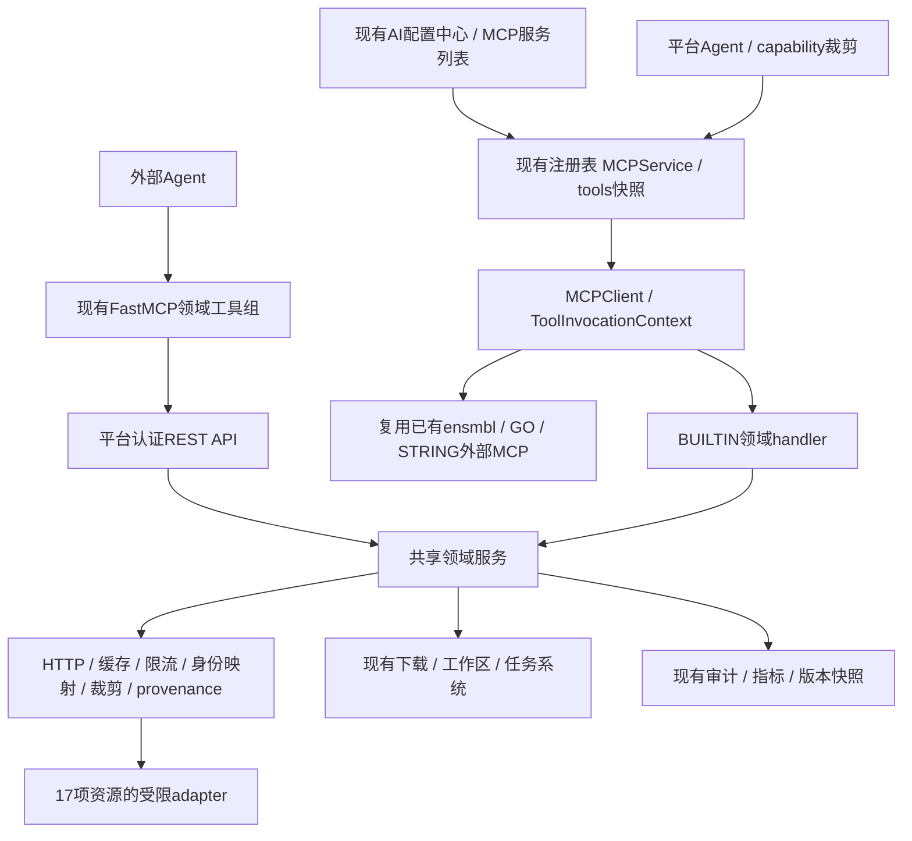

# CygnusX 科研数据库 MCP 完整实施文档

版本：2.0（整合版）  
日期：2026-10-18  
覆盖：17项资源、现有MCP复用、后端接入、前端管理、Agent提示词、测试与发布  
交付性质：研发实施规范，未修改平台源码、未注册服务、未部署。

## 0. 阅读顺序与证据等级

本文将原BioThings三库方案与新增14项调查整合为一个实施基线，不能只实现新增库而遗漏MyGene、MyVariant、MyChem。第1–14章是本次统一决策；第15章为完整API附录，保留已核查接口与待验收项。与历史文档有冲突时，以本版统一决策为准，但当前平台代码与真实运行验收仍是判断已实现状态的依据。

配套文件：`CygnusX_开发Agent实施提示词.md`可直接交给负责改代码的Agent；`CygnusX_科研Agent运行提示词.md`用于平台Router与研究Agent配置。两份历史调研文件保留为证据，不再作为并行实施方案。

证据等级：

- **S：截图可见**。只能证明页面展示，不能证明后端调用、权限或外部API健康。
- **D：附件/官方文档/schema确认**。描述架构或接口，未必代表当前部署。
- **P：本环境抽样**。小规模真实API返回，不能代替容量与平台集成测试。
- **A：实施提案**。新命名、配置、组件、预算与排期均待研发落地。

本次API抽样共58项：原三库19项均200；扩展39项中34项200，其中2项是HTML页面，不算结构化数据接口成功，另有5项证书/HTTP错误。抽样不代表58个独立端点，也不代表17库完整验收。逐项记录见`API实测记录.json`和`扩展数据库_API抽样记录.json`。

## 1. 最终架构决策

**同一套基础设施，多个领域能力组；数据库数量不等于MCP服务数量。**

1. MyGene、MyVariant、MyChem由一个正式`cygnusx-biothings` BUILTIN Preset承载，三个adapter、十个固定工具。若执行权限无法按工具分组，则三逻辑Preset共享实现，不能复制三仓库。
2. 截图已经存在的`ensmbl`、`go-server`、Europe PMC能力先盘点复用。保留现有ID、名称、绑定与transport，不为命名纠错重建服务。
3. 新增资源按领域分组：植物/TE、蛋白结构、Reactome通路、表达、临床证据。内部优先BUILTIN，外部入口复用现有FastMCP→平台API→同一服务层。
4. STRING优先评估官方Streamable HTTP MCP；需要锁定版本与统一治理时自托管或REST适配。选择一种给同一Agent暴露，避免重复同义工具。
5. 字段、物种、数据源目录动态增长，工具名与inputSchema保持稳定；禁止每个物种/字段/数据库来源新增一个工具，也不设计任意URL/GraphQL万能执行器。
6. 所有组按Agent和用户权限渐进加载；不得将全部工具一次性默认挂到每个Agent。



BUILTIN只减少MCP传输往返，不消除上游网络时延。共享基础设施不等于共享所有域的熔断或重试；单一上游故障不能使其他数据库失效。

## 2. 全部17项资源与归属

| 编号 | 资源 | 默认归属/策略 | 首次交付能力 | 当前证据 |
|---|---|---|---|---|
| 01 | MyGene | biothings/gene | search/get/resolve/metadata | D+P |
| 02 | MyVariant | biothings/variant | 显式assembly检索/详情/映射 | D+P |
| 03 | MyChem | biothings/chem | 化合物身份、注释、结构描述 | D+P |
| 04 | Ensembl Plants | **先复用现有ensmbl** | lookup/homology/region/sequence | S+D+P（现有MCP尚未调用） |
| 05 | Gramene | plant-knowledge | 搜索/详情，增量字段 | D+P |
| 06 | Dfam | plant-knowledge | 分类/家族/HMM或共识资产 | D+P |
| 07 | Expression Atlas | expression | study目录/manifest | D+P |
| 08 | Single Cell Atlas | expression | study目录/manifest | D+P |
| 09 | STRING | 官方MCP或锁版本适配 | resolve/network/partners/enrichment | D+P REST，MCP握手待测 |
| 10 | Europe PMC | **扩展现有平台能力** | 保留search，增详情/注释 | S说明+D+P |
| 11 | ClinVar | clinical-evidence | search/VCV详情 | D+P |
| 12 | Open Targets | clinical-evidence | search/关联/证据 | D+P |
| 13 | UniProt | protein-structure | resolve/features/sequence | D+P |
| 14 | RCSB PDB | protein-structure | Search发现、GraphQL详情 | D+P |
| 15 | AlphaFold DB | protein-structure | 预测模型/置信度/资产引用 | D+P |
| 16 | Reactome | pathways | 知识查询，分析分阶段启用 | D+P Content，Analysis待测 |
| 17 | InterPro | protein-structure | 域/家族及位置、相关蛋白 | D+P |

MyChem提供SMILES/InChI等结构描述，不自动具备子结构/相似性搜索或对接计算。GO不是新增17项之一，它是截图已有且需要去重的相关能力。Reactome与GO语义互补，不能因已有GO就认为Reactome已接入；同样不能重复挂多套同义GO富集工具。

## 3. 截图中的现有服务：先核对再扩展

截图位置：AI配置中心→资源中心→MCP服务。以下是截图可见值，不是实时API盘点结果。

| 服务原名 | 截图工具数 | transport | 预设 | 本次处理 |
|---|---:|---|---|---|
| seqout | 26 | builtin | 是 | 保留，不重复实现GEO/SRA等发现下载 |
| cygnusx-pipelines | 10 | builtin | 是 | 保留既有兼容/迁移策略，不随本项目下线 |
| cygnusx-tools | 49 | builtin | 是 | 盘点既有KEGG/绘图/分析，复用任务链 |
| cygnusx-platform | 22 | builtin | 是 | 保留Europe PMC search，补缺口 |
| conda-meta-mcp | 9 | stdio | 是 | 不改动 |
| go-server | 4 | stdio | 否 | 盘点本体/注释/富集覆盖，避免重复 |
| ensmbl | 19 | stdio | 否 | **保留原名与ID**；核查是否支持植物/目标端点 |

研发产出`existing_capability_inventory`：server ID、原名、transport、工具清单/inputSchema摘要、契约digest、实际物种/assembly、正常/错误样例、Agent绑定、权限与输出预算。不能凭19个工具推定Plants覆盖，也不能凭Online认定上游可用。

Ensembl处理分支：

- 现有服务满足功能/版本/权限/预算：直接绑定与说明，不新增重复工具。
- 部分满足：优先扩展现有实现；若第三方不可修改，则在共享服务层补缺口工具，按能力路由只暴露一个实现。
- 当前不可用或不满足安全条件：保留旧服务及用户配置；新增候选适配、验收后按明确映射迁移Agent，最后才决定停旧入口。不能自动删除或覆盖外部注册项。

Europe PMC已有search保持原名，详情/注释补齐后共享文章source/ID与缓存。两个入口出现同义工具时，靠能力注册/绑定去重，不依赖LLM自行判断。

## 4. 服务清单与前端行数

**前端保持现有列表样式，一个逻辑MCP注册项一行，不按17个上游数据库强制显示17行。** 下表是新增计划，不是应硬编码到页面的行或工具数量。

| 候选注册名 | transport | 上游 | 计划工具数/状态 |
|---|---|---|---|
| cygnusx-biothings | builtin | MyGene/MyVariant/MyChem | 10 |
| cygnusx-plant-knowledge | builtin | Gramene/Dfam | 5；Ensembl优先已有行 |
| cygnusx-protein-structure | builtin | UniProt/InterPro/PDB/AlphaFold | 8 |
| cygnusx-pathways | builtin | Reactome | 1知识+1分析，分析验收后启用 |
| cygnusx-expression | builtin | bulk/sc Atlas | 2；定量query后续1 |
| cygnusx-clinical-evidence | builtin | ClinVar/Open Targets | 5 |
| STRING（管理员确定显示名） | streamable_http | STRING官方MCP | 运行发现；先授权4类核心能力 |

可新增约6个内置领域Preset与1个STRING外部行，Ensembl/Europe PMC复用原行。若实际盘点发现现有功能更多，应减少新增项；若只能Server级授权则拆逻辑Preset，UI继续复用同一列表。**工具数来自后端有效注册表，不能固定写死10/8或截图旧值。** 页面总工具数、Agent有权工具数、Agent本次挂载数是不同口径，必须明确标识。

## 5. 工具契约总表

下列为新工具规划名；现有工具复用优先，不为了强制改名新增别名副本。每个字段/实体动态目录置于describe或配置中，不新增巨大oneOf。

| 领域 | 固定动作规划 | 必需语义 |
|---|---|---|
| BioThings | cygnusx_gene_search/get/resolve；variant_search/get/resolve；chem_search/get/resolve；biothings_describe | species/assembly/identifier_type与投影 |
| 现有Ensembl | 对齐lookup/homology/region/sequence | 以现场发现的真实工具名/schema为准 |
| Plant | cygnusx_plant_search、cygnusx_plant_get | Gramene实体、release、ID/物种 |
| TE | cygnusx_te_search、cygnusx_te_get、cygnusx_te_asset | 分类路径/clade、family/版本、资产类型 |
| Protein | cygnusx_protein_resolve、cygnusx_protein_features、cygnusx_protein_sequence | species、accession/isoform、证据、序列版本 |
| Domain | cygnusx_domain_get、cygnusx_domain_proteins | entry类型/蛋白位置/分页 |
| Structure | cygnusx_structure_search、cygnusx_structure_get、cygnusx_structure_prediction | experimental/predicted、entity/chain、model/覆盖 |
| Pathway | cygnusx_pathway_get、cygnusx_pathway_analyze | 物种、背景、投射与统计版本 |
| Expression | cygnusx_expression_studies、cygnusx_expression_manifest | bulk/sc、dataset、实验类型/文件身份 |
| Clinical | cygnusx_clinvar_search/get；cygnusx_target_search/associations/evidence | VCV版本/分类类型；关联证据与来源 |
| Literature | 保留europe_pmc_search，补cygnusx_literature_get/annotations | source/PMCID、全文权限、锚点/注释来源 |
| STRING | 复用官方string_*工具 | species、网络类型、score、映射与背景 |

同一get可用小而固定的sections枚举：structure_get.methods/ligands/coverage；protein_features.function/location/features。不要把methods/ligands/每个feature各做一个工具。

输入默认：additionalProperties=false；普通分页10、最大50；batch最多100；字段最多30；短query≤2048字符。**均为平台初始限制，不是各上游官方上限**，适配器需满足更小的上游限制。对gene强制明确species、variant强制assembly；coordinate、protein isoform、身份多匹配不允许静默猜测。原始DSL/GraphQL只允许受控模板与经过验证的参数。

所有工具readOnlyHint等注解只作为模型提示，权限在服务端执行；会生成外部作业或平台文件/任务的工具不得一律标只读无副作用。

## 6. 后端实施与双端接入

### 6.1 新增模块建议

```text
application/services/research_data/
  biothings_service.py
  plant_service.py
  protein_structure_service.py
  pathway_service.py
  expression_service.py
  clinical_service.py
infrastructure/research_data/
  client.py / cache.py / rate_limit.py / errors.py
  identity_mapping.py / projection.py / provenance.py
  adapters/<provider>.py
infrastructure/mcp/
  biothings_preset.py / plant_knowledge_preset.py
  protein_structure_preset.py / pathways_preset.py
  expression_preset.py / clinical_evidence_preset.py
application/schemas/research_data/   # 唯一输入/输出契约
api/v1/research_data.py              # 平台外部桥接
mcp-server/tools/research_data/      # 薄桥接，不复制业务
```

路径是建议，读取实际仓库后按既有DDD/模块约定调整。不要同时创建另一套registry、权限、任务系统或与已实现BioThings目录重复的模块。

### 6.2 数据流与上下文

Chat→Agent capability→MCPClient→handler→领域service→adapter；外部FastMCP→已认证平台API→同一service。ToolInvocationContext注入真实用户、会话、Agent与能力；模型参数不能指定user_id、工作区owner、任意路径、凭据或认证头。

schema从同一模型生成/同步；内外同能力同名、同权限、同错误语义和结果预算。内置Preset经既有ensure_presets幂等注册，保持确定性ID；不得同步时覆盖用户启停或重建第三方行。明确`reset_admin_overrides`等任何新语义前先核对当前实现，不能假设已有此配置。

### 6.3 平台API契约

新增候选路由`POST /api/v1/research-data/<domain>/<action>`，内部BioThings已采用`/api/v1/biothings/*`时沿用现有路由，别再重复。以实际共享schema生成OpenAPI。仅对上游执行受限动作；任意upstream_url/GraphQL string/文件路径不可从请求透传。

普通查询同步25s总预算；异步作业返回job/task ID并通过现有任务状态工具追踪，执行前按平台写/外发数据政策分类。只读POST不是分析提交，不要求人为构造confirmation_id；涉及真实任务提交时复用既有确认凭证与幂等链，不能接受confirmed=true。

## 7. 统一结果、资产与科学证据

内部返回业务信封`success/summary/data/next_steps`，由平台包装为llm_payload/ui_payload；外部MCP同时正确映射isError。成功HTTP不代表成功业务；GraphQL必须解析errors、partial data；HTML登陆页/实验页不能算JSON接口成功。

建议data包含：provider/database、input_context、items、pagination、provenance、warnings、partial、truncated。批量items保留input_index、input、status、matches，重复/多匹配/未找到都不丢失。provenance包含上游API版本、build/entry/sequence/model版本、assembly/species、retrieved_at、metadata时间、cache/stale、contract_digest；缺失项明确unknown，不拼造。

- llm_payload≤3000 UTF-8字节，优先保留结论依据、错误/歧义、计数和UI/文件引用；不要截断JSON字节串。
- 普通ui_payload每页建议≤512KiB；普通原始响应≤2MiB；Atlas目录缓存通道可单设10MiB；文件走独立配额。数字可配置。
- FASTA/HMM/mmCIF/PAE/表达矩阵通过下载与工作区服务交付，提供file_id/大小/hash/版本和权限检查；`asset`动作不得接受任意URL或磁盘路径。短序列可按预算内联，但结构/矩阵不直接进入模型。
- 保存upstream许可与来源；注释自由文本按不可信数据处理，不作为系统指令。

语义必须区分：相关性score与概率、功能关联与物理/调控网络、PDB实验结构与预测模型、离子/辅因子与药物、通路成员与统计富集、文本共现与因果、ClinVar不同分类类型、未找到与生物学不存在。

## 8. 前端：沿用截图同一套样式与交互

### 8.1 保留的信息架构

位置保持AI配置中心→资源中心→MCP服务。沿用现有浅色表格、蓝色操作/开关、版本徽标、服务描述、行展开箭头和操作区；复用现有组件/设计token/图标库，不另建“科研数据库控制台”，也不要求用户去新页面配置17次API。

原列保持：服务、传输、状态、工具数、预设、操作。新增领域Preset自动由同一后端列表出现；不能在Vue中写固定数据库行数组。新增可选搜索/领域筛选仅在现有组件可扩展时增加，不作为首批核心依赖。

现有组件路径由仓库核查，附件提到`frontend/src/stores/mcp.ts`、`McpResourceTab.vue`、`McpToolCallCard.vue`、`McpSelectionMenu.vue`，并不保证当前准确。先定位真实路由与组件再编辑，保持已有API封装和权限guard。

### 8.2 行与展开区

```text
> 🔌 cygnusx-biothings [v1.0.0]    builtin   Online [启用]  10  是  [现有操作]
  基因、变异、化合物聚合检索；支持批量映射和来源追溯
  展开：
    基因 MyGene      已启用 | 最近验证时间 | 3个领域工具
    变异 MyVariant   已启用 | hg19/hg38覆盖差异提示 | 3个领域工具
    化学 MyChem      已启用 | 原药/盐型身份提示 | 3个领域工具
    公共字段目录    1个工具
    工具列表：名称 / 说明 / schema查看 / 权限与测试入口
```

这是布局示意，数字是完整组规划而非硬编码运行值。下游provider信息仅在展开/配置详情中显示，不把每个字段变成表格列。

行级状态保持后端实际MCP状态；不要将builtin成功初始化渲染为所有上游健康。展开区显示各provider最近检查结果（成功/失败/未检查）、时间和错误摘要；某上游503时其他域仍可用。若现有状态枚举不含degraded，不擅自给registry写新枚举；可用附加健康说明实现。

### 8.3 操作行为

| 操作 | 期望行为 | 禁止行为 |
|---|---|---|
| 刷新 | 读取列表/状态/工具快照 | 每次刷新向17个上游高并发探测 |
| 同步预设 | 幂等注册代码Preset/契约 | 重置管理员禁用项、复制同名行、删除ensmbl |
| 启停 | 服务端权限校验；影响后续工具装配与调用 | 只改开关外观、旧会话仍可绕过执行 |
| 配置 | 域启用、预算、投影、来源许可/网络配置 | 将密钥明文返回或把任意URL开放给模型 |
| 测试 | MCP发现/握手与少量上游探针分开，结果带时间 | 只list_tools成功就宣称全部数据库健康 |
| 工具数/展开 | 后端数据驱动，区分总数/授权数 | 固定显示计划数量、把隐藏当授权 |
| 日志 | 时间/调用者/工具/provider/耗时/错误ID | 展示token、完整病历、全量变异列表 |
| 删除 | 沿用现有preset保护；外部注册按现有策略 | 删除预置资产或自动移除旧服务 |

同步状态、loading、错误重试、空列表、无权限、禁用组、provider失败、正在切换等均需有可访问反馈。状态不能只靠颜色区分，按钮需文字/tooltip及键盘可用。

### 8.4 配置表单与类型

复用现有配置抽屉/弹窗，按能力组展示：启用域、默认分页/批量、时间预算、字段profile、缓存与限流等。Admin可配source策略；普通用户只选有权限能力。NCBI API Key属于服务端secret，只显示configured标志和轮换入口，不能放普通env JSON或日志。管理员可看server transport，研究用户只需要知道可用能力和结果来源。

前端TS DTO对齐后端OpenAPI实际字段；新增provider_health时保持旧Server响应兼容，可选字段缺省显示未检查。组配置可先存既有受控配置/registry config，若确需迁移则写前后兼容迁移；不要为截图新建第二套MCP表。

### 8.5 Agent选择与聊天结果卡

MCP选择菜单复用现有行、搜索和权限过滤。按Tool Pack渐进加载，用户不需要手工挑每个API字段；管理员定义默认研究Agent能力。菜单不可见不代替执行权限。

结果卡复用现有工具调用卡：展示来源/版本、物种/assembly、命中与歧义、简要结果、完整UI分页、文件引用。结构卡标实验/预测、模型/链/分辨率或置信度；化合物卡展示原药/盐型差异；变异卡标版本与证据来源；表达卡标dataset/单位。先通用卡+可插拔section renderer，不为每个数据库独立造17套卡片。

## 9. 网络、可靠性与权限

只允许受控provider域名/端口/TLS与受限路径；下载next/Link/重定向逐跳校验，凭据不转发第三方。后端出站与Studio沙箱白名单分别配置，不关闭隔离。旧Ensembl域TLS失败不允许verify=false。

普通工具25s总预算，连接3s、读10s、池2s，最多2次总尝试；429/5xx/连接失败才在剩余预算内重试。按provider熔断；避免MCP层与HTTP层重复退避。STRING至少1s间隔，NCBI所有E-utilities共享IP/Key预算，多worker用共享原子限流。其余provider初始低并发，按实际header/授权调整。

默认元数据/fields缓存6h、身份24h、搜索1h、not_found5min作为初始工程值；临床证据与策略变化按风险缩短。缓存键包含provider/版本/species/assembly/isoform/投影/许可策略；敏感输入用户隔离，不把低熵rsID哈希当匿名化。stale返回明确标记抓取时间，不跨assembly、物种或盐型回落。

权限链：服务启用→Agent/用户有权→工具组允许→具体工具允许→参数/资产归属校验；每次调用重新执行。禁用传播到执行，不能只刷新目录；在途调用按既有取消/完成策略处理并记录，不擅自承诺即时杀死所有运行任务。

## 10. 版本、配置与回滚

保留registry IDs、外部服务配置与用户绑定。代码Preset单一事实来源；共享schema生成双端工具快照、inputSchema及描述digest。配置分环境默认值/管理员覆盖/secret，版本包只存secret引用和配置策略，不打包密钥。

发布制品包含代码版本、依赖锁、镜像digest、schema/contract_digest、默认profile与source策略版本；数据库版本快照不是制品回滚本身。候选先健康检查再激活；如现有deployment generation机制未完成，不宣称有原子切换能力，使用现有可审计维护窗口+明确回滚步骤，并保留问题清单。

feature flags按域关闭；首批默认关闭未验收的VEP、liftover、Atlas定量、Reactome分析、InterProScan、新序列预测等能力。目录中可以说明后续计划，但不得把stub注册成可用成功工具。

## 11. 实施任务与依赖

| 阶段 | 任务 | 必须交付的证据 |
|---|---|---|
| S0 现场盘点 | 读仓库约定/附件、安全runtime、发现ensmbl/GO/Europe PMC、UI组件 | 能力重叠矩阵、实际路径、保留/扩展决策 |
| S1 共享核心与BioThings | 统一schema/结果、三adapter、注册十工具、限流缓存 | 三原始数据库真实contract+边界测试 |
| S2 蛋白与植物 | 复用Ensembl、Dfam/UniProt/InterPro；Gramene受控增量 | ID/物种/分类/isoform与资产测试 |
| S3 前端贯通 | 同一列表/展开/配置/启停/测试/结果卡/权限 | 真实后端页面e2e，数据驱动计数 |
| S4 结构/证据 | PDB/AF、ClinVar/OT、STRING选型、Europe PMC扩展 | GraphQL错误/模型选择/证据解析、MCP握手 |
| S5 通路/表达 | Reactome知识、Atlas目录/manifest；分析独立验收 | 下载/背景/来源/失败恢复 |
| S6 灰度回归 | 内外双端、多worker、版本回退、旧功能 | 验收矩阵、失败证据、回滚演练 |

研发应一次性按完整计划组织交付，但只启用真实完成并验收的能力。资源尚缺密钥/网络/实例时，继续不依赖该资源的实现和测试，阻塞项单独记录，不能用mock成功冒充部署通过。

## 12. 验收矩阵与Definition of Done

| 验收域 | 关键用例 | 通过标准 |
|---|---|---|
| 覆盖 | 17资源盘点及三原始库 | 每项都有能力/关闭原因/证据，不遗漏gene/variant/chem |
| 去重 | 原ensmbl/GO/Europe PMC/seqout | ID和绑定保留；每项语义只暴露一实现 |
| schema | 双端同输入、未知参数、版本漂移 | 唯一契约，未知键拒绝，digest可追溯 |
| 物种/坐标 | human/mouse/植物、hg19/hg38、Gramene taxonomy、PDB坐标 | 无隐式跨物种/assembly/isoform合并 |
| 生物语义 | 盐型、CACTA分类、family/domain、experimental/predicted | 保留候选、分类/来源限定语 |
| 批量分页 | 0/1/100/101、重复、部分失败、多页 | 不丢项，分页与裁剪可追溯 |
| 预算 | 中文多字节、875KB条目、2.61MB目录、矩阵文件 | llm≤3000B，各通道独立限制 |
| 错误 | HTML200、GraphQL errors200、404、429、503、TLS失败 | 正确错误类型，不误报无结果/成功 |
| 权限 | tool隐藏+直接invoke、跨用户file_id、禁用后旧会话 | 执行层拒绝，敏感信息不泄露 |
| UI | 刷新/同步/开关/展开/配置/测试/日志/无权限 | 现有样式、真实数据、可访问、兼容旧行 |
| 远程MCP | STRING initialize/list_tools/call_tool真实传输 | schema预算/工具白名单/输出可解释 |
| 双端 | Chat BUILTIN与外部FastMCP真实进程 | 相同业务结果/错误/权限/预算 |
| 回归 | pipeline/tools/seqout/GO/Ensembl/文献 | 原功能与管理员设置保持可用 |
| 运行 | 多worker共享限流、取消、缓存击穿、回滚 | 不超部署预算，可恢复已验证版本 |

Done必须报告：已实现/已测试/已部署/待验收四种状态；测试命令/结果、真实请求日期、schema与制品版本、截图/日志ID、已知缺口。单元测试、mock、list_tools成功不能替代真实e2e。新增可逆文案无需堆砌测试；服务调用/权限/预算/传输/回滚必须针对风险测试。

## 13. 提示词部署方法

1. 将开发提示词与本文一并交给**具有实际CygnusX仓库权限**的开发Agent；上下文还需两份架构附件与截图。当前目录是文档输出目录，不是CygnusX源码，不能在此伪造平台实现。
2. Router提示词进入现有路由配置，研究Agent公共规则进入共享prompt片段；各专业段仅按对应Agent启用。实际工具名在盘点后用能力映射注入，不能让模型调用规划中尚未注册的名字。
3. 管理员配置、工具schema/服务端策略才是权限依据，提示词不负责保密、出站或授权强制执行。
4. 提示词和代码/schema一起纳入版本管理。每次变更跑少量固定研究问题回归，包含缺assembly、多匹配、错误与无权工具，不用真实患者数据。

## 14. 发布前关键核对

- 原三库能力明确在biothings行内，UI描述直接写“基因、变异、化合物”，避免再次被新增清单遮蔽。
- 截图已有的`ensmbl`原名不变；不因拼写而修改数据库唯一键。
- Online、启用、上游健康和Agent授权分别表达；provider最近检查可失效，展示时间。
- builtin前端数据来自注册表；新工具数和provider状态不硬编码。
- 依赖/镜像、实际运行鉴权/回环策略、连接池与URL校验以当前源码核查；历史README不得覆盖更近的runtime契约。
- 本文和API附录中的所有“待测”保留在交付报告，不提前宣布全量生产可用。

## 15. 完整API调查附录

以下收录原三库与14项扩展的详细接口、参数、真实样例与边界。历史优先级/命名仅作来源说明，统一实施以本版第1–14章为准。


### 附录A：BioThings三库

#### API 详细调查

##### 三个服务的共同能力

统一使用 HTTPS。官方部分示例仍是 HTTP，不应直接复制到生产配置。

| 能力 | MyGene | MyVariant | MyChem |
|---|---|---|---|
| 固定 base URL | `https://mygene.info/v3` | `https://myvariant.info/v1` | `https://mychem.info/v1` |
| 检索 | GET `/query` | GET `/query` | GET `/query` |
| 批量检索/映射 | POST `/query`，`q` + `scopes` | 同左 | 同左 |
| 单对象详情 | GET `/gene/{id}` | GET `/variant/{id}` | GET `/chem/{id}` |
| 批量详情 | POST `/gene`，`ids` | POST `/variant`，`ids` | POST `/chem`，`ids` |
| 构建/来源信息 | GET `/metadata` | 同左，区分 assembly | GET `/metadata` |
| 字段目录 | GET `/metadata/fields` | 同左，区分 assembly | GET `/metadata/fields` |

接口抽样无需上游 API Key 即可获得结果；这不等于平台可以免鉴权。`email` 是可选使用联系信息，不是密钥。未核实统一、长期承诺的免费配额、QPS 或 SLA，不能写入产品承诺；限流值由平台保守配置并根据 429 调整。

官方入口：[MyGene](https://docs.mygene.info/en/latest/index.html)、[MyVariant](https://docs.myvariant.info/en/latest/index.html)、[MyChem](https://docs.mychem.info/en/latest/index.html)。

##### MyGene：基因检索与注释

支持多物种。检索用 `q`；限定物种用 `species`（如 human / 9606、mouse / 10090）。详情主要接受 Entrez 和 Ensembl Gene ID；Symbol 先检索或批量映射，不能无条件塞入详情路径。

候选用途：Symbol ↔ Entrez/Ensembl/UniProt 映射、名称/功能摘要、GO、通路、转录本/蛋白标识与坐标注释。字段按实时目录发现，单基因不保证拥有每种注释。`_id` 可能是 Entrez 或 Ensembl，业务上应显式保留 `entrezgene` 与 `ensembl.gene`。

| 参数/行为 | 官方能力 | 封装建议 |
|---|---|---|
| `fields` | 返回字段投影，支持点路径 | 默认身份小集，详情按需选择 |
| `species` | 多物种或 all | **MCP 必填**，平台按研究上下文提供值，避免隐式跨物种 |
| `size/from` | 页大小/偏移；size 上限 1000 | MCP limit 默认 10、最大 50 |
| `q` | 自由词、字段、布尔、通配、区间 | 精确检索为默认，复杂 query 供高级模式 |
| POST `q/scopes` | 最多 5000 词；支持多匹配/notfound | 第一阶段每次最多 100 输入，显式 scopes |
| POST `ids` | 最多 1000，超限 400 | 不依赖上游截断，入口先校验 |
| `dotfield` | 控制嵌套/扁平格式 | 固定 false，保持一致 |

示例：GET `/query?q=symbol:CDK2&species=9606&fields=symbol,name,taxid,entrezgene&size=10`；POST `/query` 表单 `q=CDK2,TP53&scopes=symbol&species=9606&fields=symbol,entrezgene,ensembl.gene`。

文档对个别字段默认值表述存在不一致，封装永远显式传 fields，不依赖默认。坐标 assembly 从 metadata 获取，不能把所有物种都当成人类 hg38。

依据：[检索接口](https://docs.mygene.info/en/latest/doc/query_service.html)、[详情接口](https://docs.mygene.info/en/latest/doc/annotation_service.html)、[对象与物种](https://docs.mygene.info/en/latest/doc/data.html)。

##### MyVariant：变异检索与注释

定位为人类变异聚合注释。默认文档以 hg19 genomic HGVS 作为对象 ID；rsID 用 `/query` 或 POST `/query` 配 `scopes=dbsnp.rsid`，保留全部候选，不假定一个 rsID 永远对应一个等位变异。

候选注释来源包括 dbSNP、ClinVar、dbNSFP、gnomAD、CADD 等，**来源可用性必须按 assembly 与当前 metadata 判断**，不是每种 assembly 都具备同一套数据。

| 项 | 设计要求 |
|---|---|
| assembly | MCP 必填 `hg19` 或 `hg38`，写入返回、缓存键和审计 |
| HGVS | 路径正确百分号编码，例如 `>` → `%3E`；不可简单字符串拼 URL |
| `size/from/fields` | 检索投影与分页；size 官方上限 1000 |
| 区间检索 | 提供结构化 chromosome/start/end；明确 1-based inclusive，拒绝无法确认语义的转换 |
| POST `/variant` | 官方最多 1000 ID，文档称多余会省略；平台必须在请求前拒绝或分块 |
| POST `/query` | `q/scopes/fields`；文档未明确统一批量上限，不能套用 MyGene 的 5000 |
| ClinVar 等 | 保留分类、冲突、来源与可用版本，不自行输出临床结论 |

不要把 `TP53 p.R175H`、转录本 `c.` HGVS、VCF indel 直接转换为 genomic HGVS。转换涉及转录本版本、参考序列、左对齐与多等位拆分；第一阶段仅接受受支持 genomic HGVS 或经检索解析的 rsID。VCF 全量注释应作为另一个分析流程，不通过聊天工具循环完成。

**assembly 两种语义需区分**：官网 FAQ 的 `hg38=true` 描述 hg38 坐标区间查找；`assembly=hg38` 用于选择 hg38 数据集合，不能视为两个可随意替换的别名。metadata 的 assembly 切换已抽样验证；查询/详情的 hg38 行为另有补充记录。上线仍须用已知 hg19/hg38 成对位点、GET/POST 双链路做契约测试，禁止依赖“200 即参数生效”。

依据：[检索](https://docs.myvariant.info/en/latest/doc/variant_query_service.html)、[详情](https://docs.myvariant.info/en/latest/doc/variant_annotation_service.html)、[来源与 ID](https://docs.myvariant.info/en/latest/doc/data.html)、[assembly FAQ](https://myvariant.info/faq/)。

##### MyChem：化合物和药物聚合注释

它是化合物/药物注释服务，不是通用化学计算引擎。支持名称查找及 InChIKey、ChEMBL ID、ChEBI ID、PubChem CID、UNII 等标识检索/详情；对象主键优先使用 InChIKey，也可能使用来源 ID。

候选用途：化学身份、名称/别名、分子式/质量/SMILES、药物与来源注释。来源字段应从实时 metadata/fields 中按需查询。聚合来源中存在靶点或活性字段，不代表能完整替代 ChEMBL 生物活性查询，也不代表具备结构相似性、子结构搜索或分子对接功能。

| 项 | 设计要求 |
|---|---|
| 名称搜索 | 先返回候选；原药、盐型、异构体、代谢物分别保留 |
| ID 详情 | 明确 identifier_type，响应保留输入 ID 与 canonical `_id` |
| POST `/query` | `q/scopes/fields`，scopes 根据字段目录选择；不猜默认 |
| POST `/chem` | 官方最多 1000；文档称多余省略，平台防止静默丢失 |
| 数值/化学属性 | 同时保留来源字段路径、单位/类型；不把字符串误当数值 |
| 嵌套对象 | 同一个来源可能是 object 或 array，解析需支持两者 |
| 许可 | 保留 `_license` 与来源标识，商业启用按来源审查 |

实测 `imatinib` 的 total 为 18，第一页包含 IMATINIB 和 IMATINIB MESYLATE；`CHEMBL941` 解析为 `KTUFNOKKBVMGRW-UHFFFAOYSA-N`。因此“拿搜索第一条当唯一药物身份”不应作为通用策略。

依据：[检索](https://docs.mychem.info/en/latest/doc/chem_query_service.html)、[详情](https://docs.mychem.info/en/latest/doc/chem_annotation_service.html)、[对象与许可](https://docs.mychem.info/en/latest/doc/data.html)。

##### 通用分页与大结果

三个 query 接口均有 size/from、fields、sort、facets 等模式；字段能返回不等于能检索、排序或聚合，需参考字段元数据并用契约用例验证。复杂 q 必须按上游语法处理，业务精确模式与原始 DSL 模式分开，不能把所有冒号、引号统一删掉。

官方 scroll 模式 `fetch_all=true` 返回无序批次，sort 被忽略；通常每批 1000，scroll 间隔超过 1 分钟会失效，传 scroll_id 时其他参数会被忽略。**第一阶段 MCP 不暴露 fetch_all/scroll_id**。后续若加全量导出，由有配额的后台任务连续消费、原子写文件、记录中断与去重；不让 Agent 思考期间持有上游 cursor。普通分页不承诺跨上游更新的快照一致性，深分页限制由探测确认，不猜统一阈值。

#### 实测证据与边界

随附 `API实测记录.json` 记录直接请求 URL、方法、状态与摘要。首轮沙箱 DNS 不可用；获准进行公开只读联网后重试成功，不能将环境 DNS 故障误报成上游宕机。首轮 16 项与补充 3 项合计 19 项均为 HTTP 200；字段数量是目录条目数，包含父字段和子字段，不是独立数据源数。

| 服务 | 本次成功项 | metadata build_version | 字段目录条目 |
|---|---|---|---:|
| MyGene | metadata、fields、CDK2 检索、1017 详情、Symbol POST 批量 | `20260922` | 366 |
| MyVariant | hg19/hg38 metadata与fields、两集合rsID检索与HGVS详情、hg19 POST批量详情 | `20250624` | 1621（hg19）/ 979（hg38） |
| MyChem | metadata、fields、名称检索、ChEMBL 详情、POST 批量详情 | `20261006` | 1085 |

MyGene 的混合批量请求同时返回 CDK2 命中和无效输入 `notfound=true`。实测 `entrezgene` 可为字符串，不能强制要求整数。

MyVariant 的 metadata 中，默认集合含 cadd/cosmic/civic 等，hg38 集合列出的来源更少且不同。build_version 相同不代表字段和来源覆盖相同，也不能把整个构建日期当作每个子来源的更新日期。

补充实测：`rs58991260` 在 `assembly=hg19` 返回 `chr1:g.218631822G>A`，在 `assembly=hg38` 返回 `chr1:g.218458480G>A`，后者再经 hg38 详情接口确认。因此本次 GET query 的 assembly 参数实际改变了返回集合；hg38 POST query/批量详情、区间模式仍需另外验证。hg38 字段目录为 979 条。

原始 metadata 与字段目录可重复查询：[Gene metadata](https://mygene.info/v3/metadata)、[Variant metadata](https://myvariant.info/v1/metadata)、[Variant hg38 metadata](https://myvariant.info/v1/metadata?assembly=hg38)、[Chem metadata](https://mychem.info/v1/metadata)。

**尚未完成**：限流/容量探测、最大批量边界压力测试、scroll 连续消费、所有字段配置验证、所有 ID 类型、CygnusX 内外端真实传输、跨用户隔离与部署回滚。没有执行高流量测试。补充 hg38 GET 检索、详情、字段目录均成功，详见 JSON。


### 附录B：植物、蛋白、结构、通路、表达、临床与文献

#### Ensembl Plants：详细API

官方：[Plants REST说明](https://jun2026-plants.ensembl.org/info/data/rest.html)、[REST端点目录](https://rest.ensembl.org/)、[限流机制](https://github.com/Ensembl/ensembl-rest/wiki/Rate-Limits)。

**当前建议base：`https://rest.ensembl.org`。** 本次`AT3G52430`详情与植物同源查询均成功。旧`https://rest.ensemblgenomes.org`在本环境证书主机名校验失败，不能通过关闭TLS验证解决。Plants网页跳转到June 2026存档，不足以推断REST数据版本；须单独记录API数据release和assembly。

| 方法/路径 | 参数重点 | 用途/结果 |
|---|---|---|
| GET `/info/ping`、`/info/data` | JSON Accept或content-type | 连通性/发布版本 |
| GET `/info/species` | `division=EnsemblPlants` | 可用物种；本次503，应缓存与重试 |
| GET `/info/assembly/{species}` | species | assembly与染色体信息 |
| GET `/lookup/id/{id}` | `expand=1`可展开模型 | 基因/转录本/翻译对象 |
| POST `/lookup/id` | JSON `{"ids":[...]}` | 批量对象；未找到必须逐项对齐 |
| GET `/lookup/symbol/{species}/{symbol}` | species/symbol | 符号映射 |
| GET `/xrefs/id/{id}` | 可按外部库过滤 | UniProt等交叉引用 |
| GET `/homology/id/{species}/{id}` | `compara=plants`、`type=orthologues`、`target_species` | 同源关系；可含序列对齐 |
| GET `/genetree/member/id/{species}/{id}` | `compara=plants` | 基因家族树 |
| GET `/overlap/region/{species}/{region}` | 重复`feature`参数，如gene | 区间注释 |
| GET `/sequence/id/{id}` | `type=genomic/cdna/cds/protein`，按对象类型选 | 序列 |
| POST `/sequence/id` | JSON ids，参数依端点 | 批量序列 |
| GET `/sequence/region/{species}/{region}` | region如`3:19431095..19434450:1` | 区间序列 |
| GET `/map/{species}/{asm_one}/{region}/{asm_two}` | 来源/目标组装 | 仅受支持assembly间映射 |
| GET/POST `/vep/{species}/...` | 端点/物种/变异输入 | 条件开放；不能把目录存在等同某植物支持 |

示例：

```text
GET https://rest.ensembl.org/lookup/id/AT3G52430?content-type=application/json
GET https://rest.ensembl.org/homology/id/arabidopsis_thaliana/AT3G52430?compara=plants&target_species=oryza_sativa&type=orthologues&content-type=application/json
```

实测前者为PAD4，assembly TAIR10；后者返回植物同源记录。默认同源结果带`align_seq`，需要服务端投影，避免长对齐进入模型。保留orthology类型、target基因/物种、相似度和可用置信指标，不能把sequence similarity等同功能一致。

MCP建议：`cygnusx_genome_lookup`、`cygnusx_genome_homology`、`cygnusx_genome_region`、`cygnusx_genome_sequence`；物种/assembly显式传递。序列长结果作为文件引用，受控短片段可内联。VEP与liftover延后独立验收。请求遵循`X-RateLimit-*`与`Retry-After`，不把旧文档15/s示例当永久额度。

#### Gramene：详细API与增量判断

官方入口本次跳转到[release69 Swagger](https://data.gramene.org/v69/docs/?url=/v69/swagger)，机器schema：[v69/swagger](https://data.gramene.org/v69/swagger)。API schema自身version为`0.59.0`，这与数据release69是两种版本号。

base：`https://data.gramene.org/v69`。不要复制搜索结果中的旧v67。下表来自当前schema；本次实际调用search与genes，其余为schema确认，待业务样例验收。

| 方法/路径 | 参数 | 价值 |
|---|---|---|
| GET `/search` | `q`、`fl`、`fq`、`rows`、`start`、`facet.field`、`wt` | Solr基因搜索与facets |
| GET `/suggest` | `q/fq/rows/start` | 自动完成 |
| GET `/genes` | `idList`、`q`、`taxon_id`、`db_type`、`fl/rows/start` | 整合基因详情 |
| POST `/validate` | JSON `{"ids":["AT3G52430"]}` | 标识符校验 |
| GET `/genetrees`、`/maps` | `idList/q/fl/rows/start`等共享参数 | 家族树/组装 |
| GET `/pathways` | `idList/q/fl/rows/start` | 通路对象 |
| GET `/expression`、`/assays`、`/experiments` | 共享集合参数 | 表达/实验记录，需验证字段语义 |
| GET `/GO`、`/PO`、`/TO` | 共享集合参数 | Gene/Plant/Trait Ontology |
| GET `/taxonomy`、`/domains`、`/qtls`、`/germplasm` | 共享集合参数 | 分类、结构域、QTL、种质 |

`GET /search?q=AT3G52430&rows=1`返回`response.numFound=5`，首条PAD4；`GET /genes?idList=AT3G52430`返回一个24KB左右整合对象。搜索返回Content-Type为text/plain但内容是JSON，解析器需按受控端点容忍该情况，不把任意HTML当JSON。

**标识风险实测**：PAD4的Gramene `taxon_id=3702001`，Ensembl同一基因taxon为3702。即便schema描述NCBI taxonomy，也不能无校验拿该值直接请求STRING/UniProt。保存provider原始ID，通过taxonomy映射表生成canonical taxid并验证。

适合补充农作物通路、PO/TO、种质信息；与Ensembl重叠的坐标/序列/同源不重复造工具。MCP首版可只加`cygnusx_plant_search`和`cygnusx_plant_get`，后端限定实体种类和字段，不开放任意`/{collection}`或任意Solr查询。未核实长期SLA/QPS，初始低并发并缓存；冻结v69并监控release入口变化。

#### Dfam：TE家族、HMM与CACTA

官方：[API帮助](https://dfam.org/help/api)、[当前API参考](https://dfam.org/releases/current/apidocs/)、[release目录](https://dfam.org/releases/current/)。base：`https://dfam.org/api`。

| GET路径 | 参数重点 | 结果 |
|---|---|---|
| `/families` | `format=summary/full/fasta/hmm/embl`、`name/name_prefix/keywords`、`classification`、`clade`、`clade_relatives`、`type/subtype`、`include_raw`、`start/limit/sort` | 家族检索/导出 |
| `/families/{id}` | accession | 完整家族、分类、共识和证据 |
| `/classes` | `name`可筛选 | TE分类层级/别名 |
| `/families/{id}/hmm` | `format=hmm/logo/image` | HMM/展示资产 |
| `/families/{id}/sequence` | `format=fasta/embl` | 共识序列 |
| `/families/{id}/seed` | `format=stockholm/alignment_summary` | 种子比对 |
| `/families/{id}/relationships` | `include`、`include_raw` | 家族关系 |
| `/assemblies` | 无必需参数 | 有现成注释的基因组 |
| `/families/{id}/assemblies` | accession | 此家族已有注释的assembly |
| `/families/{id}/assemblies/{assembly}/annotations` | `nrph`、download | **已有**基因组注释 |
| `/families/{id}/annotation_stats` | accession | 统计 |

CACTA实测：`families?name=CACTA`为0；`classes?name=CACTA`给出完整分类路径：

```text
root;Interspersed_Repeat;Transposable_Element;Class_II_DNA_Transposition;Transposase;CACTA
```

用该classification并`include_raw=true`检索返回`total_count=55048`。**这是Dfam当前分类节点及所有后代，不能当作“某植物有55048个CACTA家族”。** 首条命中包含CMC-Chapaev子类，必须保留分类层级并按研究问题选更窄子类及clade；`include_raw=true`与默认false覆盖也不同。不要把name零命中解释为数据库没有CACTA。

MCP建议：`cygnusx_te_search`、`cygnusx_te_get`、`cygnusx_te_asset`；asset输出类型固定hmm/consensus/seed，文件由平台下载服务接管并校验哈希，模型只收引用。不是每个DR原始家族都保证有可用HMM，需检查资产存在性。对用户新植物assembly的TE注释仍应运行RepeatMasker/nhmmer等受控流程，不能把API已有注释接口当在线全基因组分析。

#### Expression Atlas与Single Cell Atlas

官方：[bulk下载](https://www.ebi.ac.uk/gxa/download)、[single-cell下载](https://www.ebi.ac.uk/gxa/sc/download)、[维护方客户端源码](https://github.com/ebi-gene-expression-group/bioconductor-ExpressionAtlas/blob/master/R/functions.R)。

| 接口/渠道 | 状态 | 适合封装 |
|---|---|---|
| GET `https://www.ebi.ac.uk/gxa/json/experiments` | 本次200 JSON；官方客户端也使用 | bulk实验目录 |
| GET `https://www.ebi.ac.uk/gxa/sc/json/experiments` | 本次200 JSON；官方客户端也使用 | 单细胞实验目录 |
| GET `https://www.ebi.ac.uk/ebisearch/ws/rest/geneExpression` | 官方客户端引用，需参数/范围验收 | 元数据检索，**不是表达值API** |
| `https://ftp.ebi.ac.uk/pub/databases/microarray/data/atlas/experiments/` | bulk文件渠道，源码引用 | 按实验目录发现文件 |
| `https://ftp.ebi.ac.uk/pub/databases/microarray/data/atlas/sc_experiments/` | 官方下载页链接 | 单细胞文件渠道 |

目录条目含`experimentAccession/Description/species/kingdom/rawExperimentType/numberOfAssays/experimentalFactors`等。bulk目录本次约2.61MB，应后台刷新与本地过滤，不每次搜索全量下载并传给LLM；这需要目录通道单独设置大于原方案2MiB的响应预算（如10MiB），不能全局放宽所有工具预算。

**不能把HTTP200都算API成功**：本次`/experiments/{id}/experiment-design`得到HTML实验页，不是预期JSON/TSV；该URL不能作为已验证结构化设计API。目录请求成功不代表某个gene或cell-type的数值查询成功。

维护方客户端对bulk baseline引用`{experiment}-tpms.tsv`/`-fpkms.tsv`及configuration.xml，对差异分析引用analytics.tsv；单细胞引用`.project.h5ad`。这些是文件布局线索，必须先从实际实验目录发现并确认文件存在，不能保证每个实验都有所有格式。官方单细胞下载页还列出原始/CPM计数、Louvain聚类、Scanpy Wilcoxon marker等，均保留具体数据集的处理版本。

建议先`cygnusx_expression_studies`+`cygnusx_expression_manifest`，返回访问号、样本/细胞数、实验类型和文件清单。第二阶段平台下载并解析矩阵，建立数据集内索引，再提供`cygnusx_expression_query`。定量结果必须包含dataset、gene ID版本、组织/细胞标签及来源、单位/归一化、统计方式和缺失说明；不可跨实验直接比较TPM/CPM，也不把“未检测到”当“绝不表达”。

#### STRING：优先评估官方MCP

官方：[API](https://string-db.org/help/api/)、[MCP说明](https://string-db.org/help/mcp/)、[远程MCP入口](https://mcp.string-db.org/)、[源码](https://github.com/meringlab/string-mcp)。

**官方已提供Streamable HTTP MCP：`https://mcp.string-db.org/`。** 提供蛋白解析、网络、partners、富集、功能注释、同源与物种查询等工具。官网说明服务仍在开发，远程地址跟随最新版；CygnusX接入前必须抓取tools/schema、限制暴露工具、真实握手与调用测试，不能把网页列出工具当成已完成MCP集成。

生产两条路径：

- 探索型Agent可先注册官方远程MCP，复用现有外部Server管理、审计与工具白名单；先开放少量核心只读工具。检查远程输出能否进入平台3000B包装，禁用create_file等暂不需要能力。
- 强可复现、统一缓存/限流或离线制品要求较高时，使用锁定commit自托管官方实现，或用REST适配器；不同时让Agent看到两套同名同义STRING工具。

REST base当前实测version为12.5，stable address为`https://version-12-5.string-db.org`。

| GET/POST路径 | 主要参数 | 内容 |
|---|---|---|
| `/api/json/version` | 无 | 版本和稳定域名 |
| `/api/json/get_string_ids` | identifiers、species、echo_query、caller_identity | 名称映射 |
| `/api/json/network` | identifiers、species、required_score、network_type、add_nodes | 集合内部网络 |
| `/api/json/interaction_partners` | identifiers、species、limit、required_score、network_type | 互作伙伴 |
| `/api/json/enrichment` | identifiers、species等，按当前端点参数 | 功能富集 |
| `/api/json/ppi_enrichment` | identifiers、species | 互作数量富集 |
| `/api/json/functional_annotation` | identifiers、species | 注释 |
| `/api/json/homology` | identifiers、species等 | 同源信息 |
| `/api/image/network` | 同网络参数 | 图片，模型用结构化边表为主 |

多ID按换行分隔，较长列表用POST；species为必填平台约束；提供caller_identity。按官网建议调用间隔至少1秒，部署级共享限流，不按worker分别1/s。required_score输入尺度0–1000，输出score尺度应按端点核验，不混为概率。单蛋白查询可能自动扩邻居，平台需显式设置并报告新增节点。

当前API有functional/physical/regulatory类型，版本兼容须验收；regulatory是方向预测并可能带符号，不代表每条都有实验验证。富集需报告映射率、多重校正与背景定义；小麦等多倍体先明确基因/蛋白映射，不能将丢失ID静默移除。

许可：[STRING CC BY4.0](https://version-12-5.string-db.org/cgi/access?footer_active_subpage=licensing)，保留署名并核对嵌入第三方内容条款。

#### Europe PMC：扩展现有工具而非重复接入

平台附件已列出`europe_pmc_search`；实际实现与能力需代码核对。建议补详情、OA全文和注释，复用已有检索与结果ID。

官方：[文章REST](https://europepmc.org/RestfulWebService)、[Annotations](https://europepmc.org/annotationsapi)。文章REST base为`https://www.ebi.ac.uk/europepmc/webservices/rest`。

| 方法/路径 | 参数重点 | 用途 |
|---|---|---|
| GET `https://www.ebi.ac.uk/europepmc/webservices/rest/search` | query、format=json、resultType=lite/core、pageSize、cursorMark | 搜索/摘要与元数据 |
| GET `/fields`（相对文章REST base） | format | 可查询字段 |
| GET `/{source}/{id}/references`（相对文章REST base） | format、pageSize等 | 参考文献 |
| GET `/{source}/{id}/citations`（相对文章REST base） | 同上 | 引用文献 |
| GET `/{PMCID}/fullTextXML`（相对文章REST base） | PMCID | 可取得的OA全文XML |
| GET `https://www.ebi.ac.uk/europepmc/annotations_api/annotationsByArticleIds` | articleIds如MED:29165669、format=JSON | 按文章注释 |
| GET同annotations_api下`annotationsByEntity` | entity等，以当前文档为准 | 按实体 |
| GET同前缀`annotationsByRelationship` | 两实体及类型，待schema核定 | 特定关系注释 |
| GET同前缀`annotationsByProvider`、`annotationsBySectionAndOrType` | provider/section/type | 按来源/章节/类型 |

首个cursorMark用`*`，后续使用`nextCursorMark`；模型侧只看到平台游标。源代码不同PMID/PMCID不可互换；保留MED/PMC等source。

本次文章search与`annotationsByArticleIds?articleIds=MED:29165669&format=JSON`均得到结构化结果，注释含exact/prefix/postfix/type/section/provider/tags URI。不得把普通gene与disease共同出现自动转成关联；只有明确关系注释才保留关系标签，且仍是文本挖掘证据。全文受OA/授权范围约束，保留段落锚点和license，不承诺所有文献可全文获取。

建议新增`cygnusx_literature_get`、`cygnusx_literature_annotations`；全文解析可并入get的固定section枚举，按需分段，不把整篇XML塞入llm_payload。未核实注释端点的所有限额，不沿用文章search参数去猜annotations分页。

#### ClinVar：原始证据直连

官方：[访问及E-utilities说明](https://www.ncbi.nlm.nih.gov/clinvar/docs/maintenance_use/)、[当前数据访问](https://www.ncbi.nlm.nih.gov/clinvar/docs/access/)、[NCBI限流规则](https://www.ncbi.nlm.nih.gov/books/NBK25497/?report=printable)。

base：`https://eutils.ncbi.nlm.nih.gov/entrez/eutils`。

| GET/POST路径 | 参数 | 内容 |
|---|---|---|
| `/esearch.fcgi` | db=clinvar、term、retmode=json、retmax、retstart | 搜索UID；term如FGFR3[gene] |
| `/esummary.fcgi` | db=clinvar、id、retmode=json | 摘要、版本、坐标、临床分类概览 |
| `/efetch.fcgi` | db=clinvar、id=VCV...、rettype=vcv、retmode=xml | 完整变异中心记录 |
| `/efetch.fcgi` | id=VCV...版本号、rettype=vcv | 指定版本 |
| `/efetch.fcgi` | id=RCV...、rettype=clinvarset | 变异-疾病记录 |
| `/elink.fcgi` | dbfrom=clinvar、db=pubmed/medgen、id | 文献或疾病标识链接 |

数字Variation ID与Entrez UID/VCV关系要依据当前文档处理；用ESearch结果做后续查询，或直接用VCV accession。不要假定Allele ID、Variation ID、RCV/SCV互换。EFetch数字ID模式当前文档涉及`is_variationid/from_esearch`，应显式使用已验收路径；本文实测使用VCV accession。

本次摘要65533返回`VCV000065533.11`，EFetch完整XML成功。解析XML禁用外部实体，支持schema演进；保留版本、review status、submitter/assertion、条件、最后评估日期和证据来源。germline classification、somatic clinical impact、oncogenicity不能合并成一个pathogenic布尔值；SCV提交冲突不能被一个总分掩盖。

无Key通常共享IP上限3请求/s；API Key默认支持10请求/s，以NCBI当前授权为准。整个NCBI E-utilities调用统一预算，不能ClinVar与PubMed各自耗满同一IP配额。tool/email由管理员设置，Key只在服务端保管。

MCP建议`cygnusx_clinvar_search`、`cygnusx_clinvar_get`。与MyVariant比较时标明各自抓取/源版本；不默认直连字段一定更新、更不简单覆盖冲突。ClinVar本身要求专业审阅后用于医学决策，工具输出保留证据性质。

#### Open Targets：固定GraphQL模板

官方：[API文档](https://platform-docs.opentargets.org/data-access/graphql-api)、[当前SDL schema](https://api.platform.opentargets.org/api/v4/graphql/schema)。唯一查询HTTP端点：`POST https://api.platform.opentargets.org/api/v4/graphql`，JSON body含query/variables。

| GraphQL根字段/子字段 | 标识与分页 | 封装能力 |
|---|---|---|
| `search(queryString,entityNames,page)` | page.index/size | 名称解析与实体搜索 |
| `mapIds(queryTerms,entityNames)` | 当前schema提供，未抽样 | 批量实体映射 |
| `target(ensemblId)` | 人类Ensembl Gene ID | 靶点信息/tractability |
| `target.associatedDiseases(page)` | count/rows、可选filters | 靶点→疾病 |
| `disease(efoId).associatedTargets(page)` | EFO/MONDO等Platform有效ID | 疾病→靶点 |
| `target.evidences(efoIds,size,cursor)` | 游标/来源过滤 | 证据下钻 |
| `drug(chemblId)` | ChEMBL molecule ID | 药物注释 |
| `target.drugAndClinicalCandidates` | 当前schema字段 | 靶点药物/临床候选 |
| `variant(variantId)`、`study`、`credibleSet` | 各自规范ID | 后续遗传证据扩展 |
| `meta`、`associationDatasources` | 数据版本/来源 | provenance与目录 |

**避免旧模板漂移**：本次SDL中没有旧`knownDrugs`字段，相关能力为`drugAndClinicalCandidates`；新schema也有targets/diseases/drugs批量根字段，但官方仍建议大规模系统性分析用下载/BigQuery，不能据字段存在就高并发逐条遍历。

实测模板：

```graphql
query($id: String!) {
  target(ensemblId: $id) {
    id
    approvedSymbol
    associatedDiseases(page: {index: 0, size: 2}) {
      count
      rows { disease { id name } score }
    }
  }
}
```

variables：`{"id":"ENSG00000141510"}`。本次得到TP53关联count=5198、前两项疾病与score。该数量与默认过滤/间接关联传播及版本有关，不能称为5198条独立临床验证。score为0–1关联证据聚合量，不是致病概率。

MCP建议`cygnusx_target_search`、`cygnusx_target_associations`、`cygnusx_target_evidence`，known-drug信息可按固定section加入详情。禁止向模型开放任意GraphQL；模板固定、variables严格校验、嵌套深度/页大小上限。HTTP200同时检查`errors`和partial data，并记录schema哈希与数据release。

#### UniProt：优先补足蛋白底座

官方：[API入口](https://www.uniprot.org/api-documentation)、[程序访问](https://www.uniprot.org/help/api)、[字段说明](https://www.uniprot.org/help/return_fields)。帮助页部分为JS渲染，本次具体字段同时经过真实REST响应核查。

base：`https://rest.uniprot.org`。

| 方法/路径 | 参数 | 用途 |
|---|---|---|
| GET `/uniprotkb/search` | query、fields、format=json/tsv/fasta、size、cursor、sort | 受限搜索与投影 |
| GET `/uniprotkb/{accession}.json` | accession/isoform依据支持情况 | 完整条目，后端提取comments/features |
| GET `/uniprotkb/{accession}.fasta` | 明确canonical或isoform ID | FASTA |
| GET `/uniprotkb/stream` | query/fields/format | 大量导出，不开放聊天全量流 |
| POST `/idmapping/run` | form from/to/ids | 异步ID映射任务 |
| GET `/idmapping/status/{jobId}` | jobId | 映射状态 |
| GET `/idmapping/details/{jobId}` | jobId | 结果地址 |
| GET `/idmapping/results/{jobId}` | size/cursor/format等 | 结果页；先核实际redirectURL |
| GET `/configure/idmapping/fields` | 无 | 可用from/to名称，实施时冻结核查 |

后三组异步映射端点为官方当前REST模式的实施候选，**本次未提交映射任务或验证全部ID类型**。不得使用搜索结果里旧cgi-bin接口。Gene Symbol以search+organism为主；Ensembl Gene/Transcript/Protein要分清from类型，读取配置支持列表，保留一对多映射及isoform。

实测query：`(gene_exact:TP53) AND (organism_id:9606)`，fields为`accession,id,protein_name,gene_names,organism_id,length,reviewed`，size=2；得到reviewed P04637与另一unreviewed候选。推荐默认优先reviewed，但不能在缺reviewed时静默认定没有蛋白；报告fallback策略。

P04637完整JSON本次874741字节。按以下结构重组，不能截断原JSON前3000字节：

- 身份：primaryAccession、entryType、gene/organism、sequence.length、entryAudit。
- 功能：comments中FUNCTION，只保留有限摘要及证据引用。
- 亚细胞定位：SUBCELLULAR LOCATION，保留注释限定语和证据。
- 特征：features按类型/区间筛选，保留坐标修饰符与证据；不将未知/模糊边界硬转换整数。
- PTM/结合/突变位点：按请求返回必要项，不默认输出所有天然变异。
- 序列：短序列可受限返回；长序列写受控工作区文件，提供长度、checksum、sequence version。

建议沿用用户提出的三个动作，名称对齐平台：`cygnusx_protein_resolve`、`cygnusx_protein_features`、`cygnusx_protein_sequence`；蛋白功能/定位可作为features固定section。分页遵循服务端Link/cursor，校验后续URL仍属于允许host/path；缓存包含accession、isoform、条目版本、序列版本。

#### RCSB PDB：Search查ID，GraphQL取详情

官方：[API总览](https://www.rcsb.org/docs/programmatic-access/web-apis-overview)、[Search API](https://search.rcsb.org/)、[Data API](https://data.rcsb.org/)。

| 方法/地址 | 功能 |
|---|---|
| POST `https://search.rcsb.org/rcsbsearch/v2/query` | JSON搜索语法，Boolean、字段/序列/结构搜索 |
| POST `https://data.rcsb.org/graphql` | 固定GraphQL模板，精确读取已知结构 |
| GET `https://data.rcsb.org/rest/v1/core/entry/{entry_id}` | 结构条目完整元数据 |
| GET同core前缀`/polymer_entity/{entry}/{entity}` | 蛋白/核酸实体及映射 |
| GET同前缀`/nonpolymer_entity/{entry}/{entity}` | 小分子实体 |
| GET同前缀`/chemcomp/{component}` | 化学组分 |
| GET `https://files.rcsb.org/download/{entry}.cif` | 结构坐标文件，下载通道另验收 |

搜索UniProt：终端text条件attribute为`rcsb_polymer_entity_container_identifiers.reference_sequence_identifiers.database_accession`、operator=exact_match、value=P04637；正式模板再加database_name=UniProt限定防跨库歧义。`return_type=polymer_entity`可保留匹配到哪个蛋白实体；`results_content_type=["experimental"]`排除计算模型，分页`start/rows`。本次单accession条件返回325个polymer entities，不等于325个独立PDB结构；若要结构数需按entry去重。

已实测详情模板：

```graphql
{
  entry(entry_id: "1TUP") {
    rcsb_id
    exptl { method }
    rcsb_entry_info { resolution_combined }
    nonpolymer_entities {
      pdbx_entity_nonpoly { comp_id name }
      nonpolymer_comp { chem_comp { id name type } }
    }
  }
}
```

返回X-RAY DIFFRACTION、2.2Å、非聚合组分ZN（锌离子）。**结构里有某组分并不证明其是药物、直接结合目标蛋白、或具有活性。** 应区分离子/辅因子/溶剂/其他组分；结合位点或链接触需进一步结构分析。

MCP建议：`cygnusx_structure_search`、`cygnusx_structure_get`；get.sections=methods/ligands/coverage，覆盖用户提出的三个意图同时减少工具数。必须保留entry/entity/asym链ID、实验方法、分辨率单位及缺失、UniProt覆盖区间、序列差异与突变；NMR没有分辨率不代表质量差。PDB residue编号含auth/label、插入码，不能直接套UniProt或InterPro位置。结构文件首选mmCIF，不硬编码PDB ID只允许4字符。

#### AlphaFold DB：模型与置信度

官方：[API](https://alphafold.ebi.ac.uk/api-docs)、[模型置信度](https://www.ebi.ac.uk/training/online/courses/alphafold/inputs-and-outputs/evaluating-alphafolds-predicted-structures-using-confidence-scores/)、[pLDDT解释](https://www.ebi.ac.uk/training/online/courses/alphafold/inputs-and-outputs/evaluating-alphafolds-predicted-structures-using-confidence-scores/plddt-understanding-local-confidence/)。

核心：`GET https://alphafold.ebi.ac.uk/api/prediction/{uniprot_accession}`。

本次P04637返回**9个条目**，含canonical与isoforms；首条`AF-P04637-F1`、latestVersion=6，返回cifUrl/pdbUrl/bcifUrl/paeDocUrl、globalMetricValue与置信区间占比。isoform如P04637-9有独立模型。不要硬拼`model_v4.pdb`或把模型版本6称作AlphaFold算法第6代。

MCP `cygnusx_structure_prediction`必传UniProt accession，可选isoform/model ID；返回所有候选身份和模型覆盖，用户/Agent明确选择。获取文件使用API返回URL并校验允许域名、HTTPS、文件类型/大小与哈希；PAE矩阵不直接传给LLM，按所选区域摘要。

质量解释：pLDDT是局部置信度，通常>90较高、70–90较好、50–70低、<50很低；高局部pLDDT不能保证结构域相对位置正确，应结合PAE和目标区域。低置信区域可与无序有关，不能直接据此证明生物学无序。预测结构无实验分辨率；B-factor字段在模型中可能存pLDDT，不与实验热运动因子混用。

PDB没有某结构时可查询AFDB，但结果类型始终标experimental/predicted；不可承诺“没有实验结构一定有高质量预测”，也不能仅凭结构对接或配体近邻推断药效。

#### InterPro：结构域与蛋白家族

官方：[API](https://www.ebi.ac.uk/interpro/api/)、[维护方API文档](https://github.com/ProteinsWebTeam/interpro7-api)。base：`https://www.ebi.ac.uk/interpro/api`，保留路径末尾斜杠并遵循返回的next游标。

| GET路径 | 参数 | 用途 |
|---|---|---|
| `/protein/uniprot/{accession}/` | accession | 蛋白元数据 |
| `/entry/interpro/protein/uniprot/{accession}/` | page_size | 已知蛋白InterPro家族/域与区间 |
| `/entry/interpro/{IPR}/` | IPR accession | 条目详情 |
| `/entry/pfam/{PF}/` | PF accession | 成员库模型 |
| `/protein/uniprot/entry/interpro/{IPR}/` | page_size，可用taxonomy filter以端点核验 | 含某条目的蛋白列表 |
| `/entry/interpro/` | search、page_size等，以API帮助为准 | 条目检索 |

本次P04637蛋白详情成功，entry交叉端点count=9，响应提供next/previous/results；结果含metadata.type、成员数据库、GO，以及`entry_protein_locations.fragments`位置。部分是family而非domain，必须保留类型，不能把所有命中都叫结构域。

建议`cygnusx_domain_get`、`cygnusx_domain_proteins`；protein features可桥接InterPro结果但保留来源。命中同一结构域不等于全长同源，序列相似性/直系同源判断交给独立证据。**给全新FASTA做域识别需要InterProScan作业/API，不是此查询API直接扫描**；计算接入作为独立Flow，结果保留工具版本与成员库版本。

#### Reactome：知识与富集分开

官方：[Content Service](https://reactome.org/dev/content-service)、[Analysis Service](https://reactome.org/dev/analysis/)。

| 方法/路径 | 参数/输入 | 内容 |
|---|---|---|
| GET `https://reactome.org/ContentService/data/database/version` | 无 | release，本次成功 |
| GET `/ContentService/data/query/{stable_id}` | 如R-HSA-1640170 | 通路/反应对象，本次成功 |
| GET `/ContentService/data/pathways/top/{species}` | species名称或ID按API定义 | 顶层通路 |
| GET `/ContentService/data/pathway/{stable_id}/containedEvents` | pathway ID | 子反应 |
| GET `/ContentService/data/mapping/UniProt/{accession}/pathways` | UniProt ID | 蛋白通路映射；实施候选待抽样 |
| POST `https://reactome.org/AnalysisService/identifiers/` | text/plain标识列表 | 分析，不自动投射人类 |
| POST `/AnalysisService/identifiers/projection/` | text/plain列表 | 人类投射分析，必须显式选择 |
| GET `/AnalysisService/token/{token}` | 结果token与分页/过滤 | 已提交分析结果；具体参数由当前文档验证 |

Analysis查询通常用pageSize/page分页，返回pathways、匹配实体、pValue/FDR及结果token；当前本轮只核查Content两个GET，**未提交富集分析任务**，因此不把富集接口写为实测通过。

MCP建议`cygnusx_pathway_get`、`cygnusx_pathway_analyze`，后者是分析而非纯知识查询，需独立输入配额/超时与结果生命周期。保留输入ID类型、去重、成功映射/未映射数、物种、是否投射、背景定义、检验与FDR方法、release。若公共服务不支持所需自定义背景，应返回能力限制或在平台用版本化基因集本地分析，不能默默使用全基因组背景后宣称适合所有scRNA-seq DEG。

Reactome主资源与**Plant Reactome**不能视为完全相同的数据覆盖。植物通路优先核对Gramene/Plant Reactome物种与推断来源；不把植物基因默认投射成人类。共通路、富集、调控方向三者分别表达。


